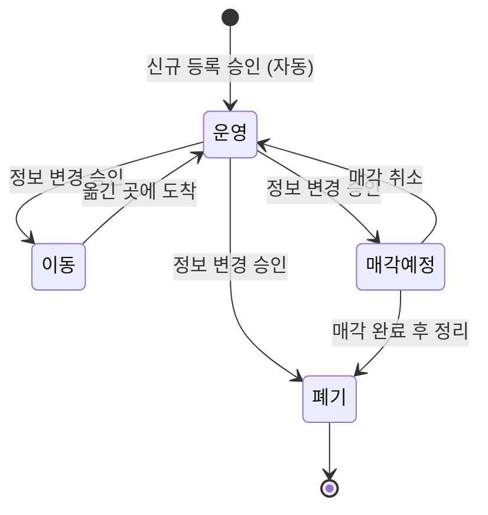
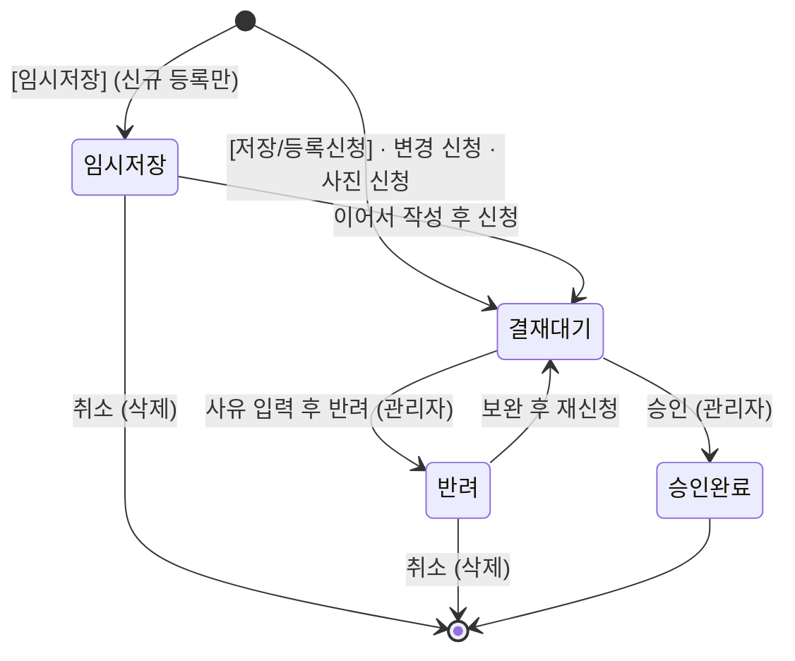
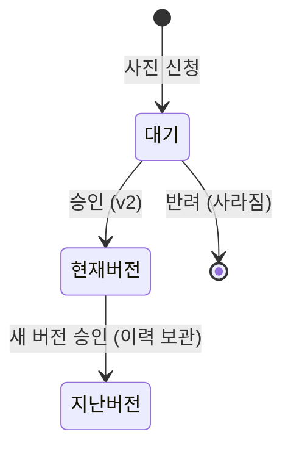
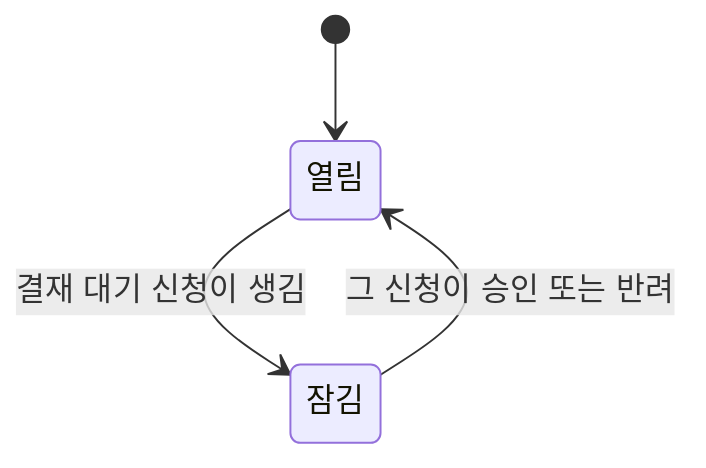
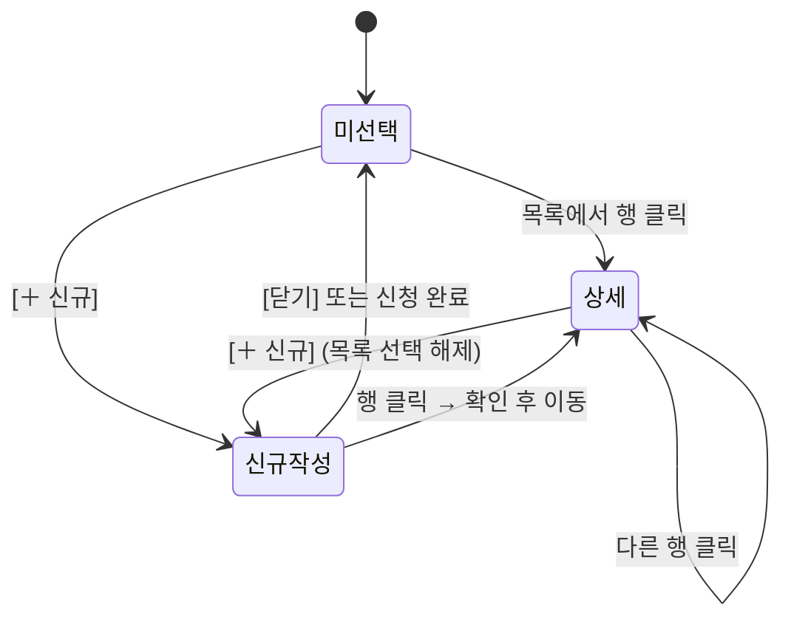

# RMS 상태 전이 정리

> [[6주차]] · 자산관리에서 **상태가 바뀌는 곳은 6군데**예요.
> 앱 코드에 실제로 구현된 동작을 기준으로 정리했어요.

## 전체 목록

| No  | 대상                     | 상태                        |      구현 여부       |
| :-: | ---------------------- | ------------------------- | :--------------: |
|  ①  | 자산 상태 (생애주기)           | 운영 · 이동 · 매각예정 · 폐기       | ⚠️ 일부 (전이 제한 없음) |
|  ②  | 신청(결재) 상태              | 임시저장 · 결재 대기 · 승인 완료 · 반려 |        ✅         |
|  ③  | 승인 시 자산 반영             | 신청 유형별로 자산이 바뀜            |        ✅         |
|  ④  | 사진 버전                  | 대기 · 현재 버전 · 지난 버전        |        ✅         |
|  ⑤  | 자산 신청 잠금               | 열림 · 잠김                   |        ✅         |
|  ⑥  | 화면 상태 (자산 정보 관리 하단 영역) | 미선택 · 상세 · 신규 작성          |        ✅         |

---

## ① 자산 상태 (생애주기)

| 변경전  | 변경후            | 언제                    | 누가        |
| ---- | -------------- | --------------------- | --------- |
| (없음) | 운영             | 신규 등록 신청이 승인될 때 자동    | 시스템       |
| 운영   | 이동 / 매각예정 / 폐기 | 정보 변경 신청에서 상태를 바꾸고 승인 | 신청자 → 관리자 |
| 이동   | 운영             | 옮긴 곳에 도착              | 신청자 → 관리자 |
| 매각예정 | 운영             | 매각 취소                 | 신청자 → 관리자 |
| 매각예정 | 폐기             | 매각 완료 후 정리            | 신청자 → 관리자 |
| 폐기   | (없음)           | 마지막 상태                | –         |

---

## ② 신청(결재) 상태

| 지금 | 다음 | 언제                        | 누가  |
|---|---| ------------------------- | --- |
| (없음) | 임시저장 | 등록 폼에서 [임시저장] (신규 등록만 가능) | 신청자 |
| (없음) | 결재 대기 | [저장/등록신청], 변경 신청, 사진 신청   | 신청자 |
| 임시저장 | 결재 대기 | 이어서 작성 후 신청               | 신청자 |
| 결재 대기 | 승인 완료 | 승인                        | 관리자 |
| 결재 대기 | 반려 | 사유를 적어 반려                 | 관리자 |
| 반려 | 결재 대기 | 보완 후 재신청                  | 신청자 |
| 임시저장 · 반려 | 삭제 | 취소 (기록이 사라짐)              | 신청자 |

> [!note] 막혀 있는 것
> - 결재 대기 중에는 **취소할 수 없어요**.
> - 승인 완료된 건은 **다시 바꿀 수 없어요**.
> - 이미 처리된 건은 **다시 승인하거나 반려할 수 없어요**.

---

## ③ 승인 시 자산 반영 (신청 유형별)

| 신청 유형 | 승인되면 | 반려되면 |
|---|---|---|
| 신규 등록 | 자산이 새로 생기고 상태는 '운영' | 자산이 생기지 않음 |
| 정보 변경 | 신청한 항목만 새 값으로 바뀜 (상태를 바꿨다면 ① 전이가 일어남) | 그대로 |
| 사진 변경 | ④의 새 사진 버전이 생김 | 그대로 |

---

## ④ 사진 버전

| 지금 | 다음 | 언제 |
|---|---|---|
| (없음) | 대기 | 사진 신청 (화면에 '결재 대기 중인 사진 신청 1건' 표시) |
| 대기 | 현재 버전 (v2) | 승인 |
| 현재 버전 (v1) | 지난 버전 | 새 버전이 승인될 때. 지우지 않고 형상 이력에 보관 |
| 대기 | (사라짐) | 반려 |

---

## ⑤ 자산 신청 잠금

| 지금 | 다음 | 언제 | 효과 |
|---|---|---|---|
| 열림 | 잠김 | 그 자산에 결재 대기 신청이 생김 | 같은 자산에 새 변경·사진 신청 불가 |
| 잠김 | 열림 | 그 신청이 승인되거나 반려됨 | 다시 신청 가능 |

---

## ⑥ 화면 상태 (자산 정보 관리 하단 영역)

| 지금 | 다음 | 언제 |
|---|---|---|
| 미선택 | 상세 | 목록에서 행 클릭 |
| 상세 | 다른 자산 상세 | 다른 행 클릭 |
| 미선택 · 상세 | 신규 작성 | [＋ 신규] 클릭 (목록 선택이 풀림) |
| 신규 작성 | 미선택 | [닫기] 또는 신청 완료 |
| 신규 작성(입력 중) | 상세 | 행 클릭 → "작성 중인 내용이 사라집니다" 확인 후 이동 |

---

## 정리

| 구분 | 상태 전이 | 어디에 넣나 |
|---|---|---|
| 업무 규칙 | ①, ②, ③, ⑤ | 요구사항 정의서 '상태 전이표' · 통합시험 결과서 테스트 케이스 |
| 화면 동작 | ④, ⑥ | 화면정의서 |
| 고쳐야 할 것 | ① 자산 상태의 전이 제한이 앱에 없음 | 앱 수정 |

## 다음 할 일

- [ ] 요구사항 정의서에 '상태 전이표'(①②③⑤) 넣기
- [ ] 통합시험 결과서에 상태 전이 테스트 케이스 추가
- [ ] 화면정의서에 ④⑥ 화면 동작 반영
- [ ] 앱에 ① 자산 상태 전이 제한 반영 (예: 폐기 → 운영 막기)
