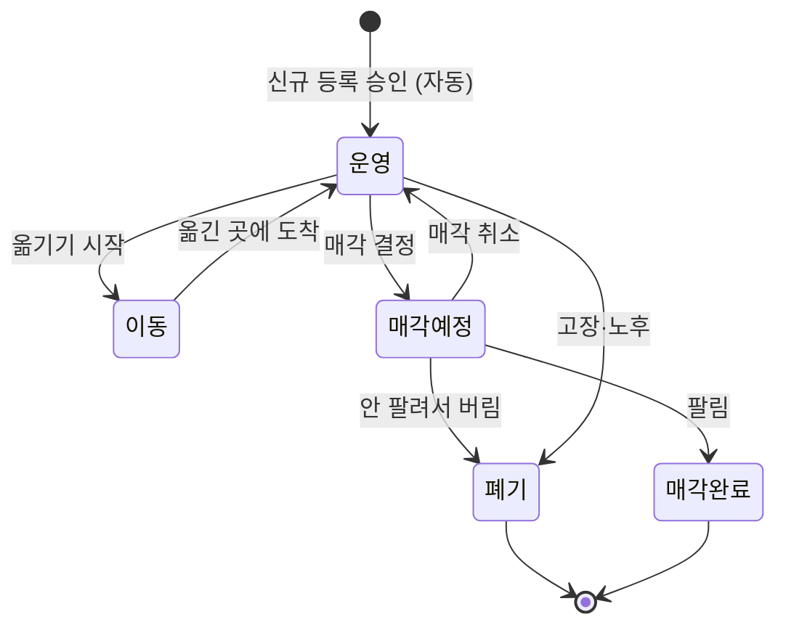
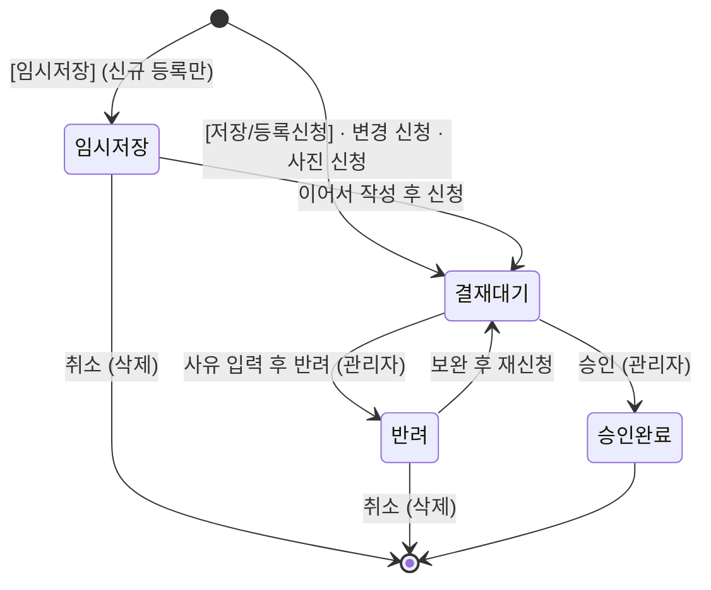
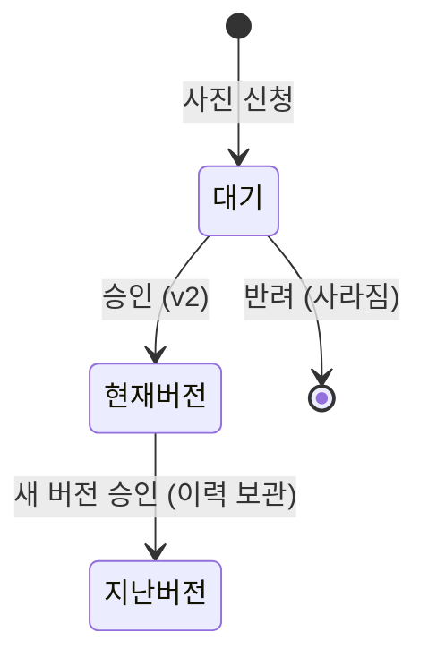
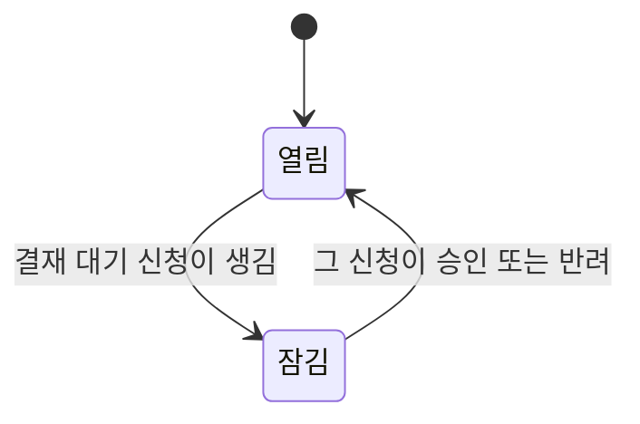
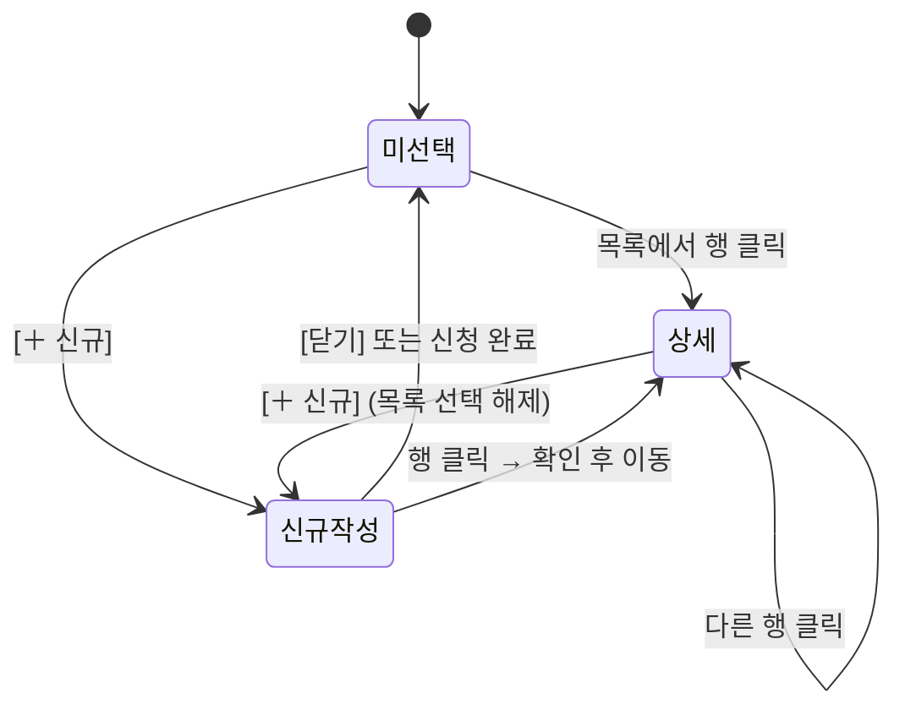

# RMS 상태 전이 정리

> [[6주차]] · 자산관리에서 **상태가 바뀌는 곳은 6군데**예요.
> 앱 코드에 실제로 구현된 동작을 기준으로 정리했어요. (2026-11-11 매각완료(50) 추가 반영)

## 전체 목록

| No  | 대상                     | 상태                         |
| :-: | ---------------------- | -------------------------- |
|  ①  | 자산 상태 (생애주기)           | 운영 · 이동 · 매각예정 · 폐기 · 매각완료 |
|  ②  | 신청(결재) 상태              | 임시저장 · 결재 대기 · 승인 완료 · 반려  |
|  ③  | 승인 시 자산 반영             | 신청 유형별로 자산이 바뀜             |
|  ④  | 사진 버전                  | 대기 · 현재 버전 · 지난 버전         |
|  ⑤  | 자산 신청 잠금               | 열림 · 잠김                    |
|  ⑥  | 화면 상태 (자산 정보 관리 하단 영역) | 미선택 · 상세 · 신규 작성           |

---

## ① 자산 상태 (생애주기)

### 상태 코드 (공통코드 ASSET_STATUS)

| 코드 | 상태 | 뜻 | 예시 |
| :-: | ---- | --- | --- |
| 10 | 운영 | 누군가 쓰고 있는 자산 | 경영지원팀 직원이 쓰는 노트북 |
| 20 | 이동 | 다른 부서·장소로 옮기는 중 | 공공사업팀으로 택배 보내는 2~3일 |
| 30 | 매각예정 | 팔기로 정해 넘겨주기를 기다림 | 중고 업체가 가져가기 전 노트북 20대 |
| 40 | 폐기 | 고장·노후로, 또는 팔리지 않아 버림 (마지막 상태) | 고장 난 모니터를 폐기물 업체에 넘김 |
| 50 | 매각완료 | 팔아서 넘겨줌 (마지막 상태) | 중고 업체에 노트북을 넘기고 대금을 받음 |

### 상태 전이표 (○ 가능, × 불가)

| 지금 \ 다음 | 운영 | 이동 | 매각예정 | 폐기 | 매각완료 |
| --- | :-: | :-: | :-: | :-: | :-: |
| 운영 | - | ○ | ○ | ○ | × |
| 이동 | ○ | - | × | × | × |
| 매각예정 | ○ | × | - | ○ | ○ |
| 폐기 | × | × | × | - | × |
| 매각완료 | × | × | × | × | - |

### 전이 상세

| 변경전  | 변경후            | 언제                    | 누가        |
| ---- | -------------- | --------------------- | --------- |
| (없음) | 운영             | 신규 등록 신청이 승인될 때 자동 (등록 화면에서 상태 선택 없음) | 시스템       |
| 운영   | 이동 | 다른 부서·장소로 옮기기 시작할 때 | 신청자 → 관리자 |
| 운영   | 매각예정 | 팔기로 결정했을 때 | 신청자 → 관리자 |
| 운영   | 폐기 | 고장·노후로 버릴 때 | 신청자 → 관리자 |
| 이동   | 운영             | 옮긴 곳에 도착해 다시 쓰기 시작할 때 | 신청자 → 관리자 |
| 매각예정 | 운영             | 매각 취소 (값이 안 맞음, 다시 필요해짐 등) | 신청자 → 관리자 |
| 매각예정 | 매각완료 | 팔려서 넘겨주었을 때 | 신청자 → 관리자 |
| 매각예정 | 폐기             | 팔리지 않아 결국 버릴 때 | 신청자 → 관리자 |
| 폐기 · 매각완료 | (없음)           | 마지막 상태. 다시 바꿀 수 없음 | –         |

> [!tip] 매각완료와 폐기를 나누는 이유
> - 둘 다 '폐기'로 두면 **판 자산과 버린 자산을 구분할 수 없어요**.
> - "작년에 판 자산은 몇 대?" 같은 감사·회계 질문에 답하려면 끝 상태를 둘로 나눠야 해요.
> - 운영에서 바로 매각완료로는 갈 수 없어요. 반드시 **매각예정을 거쳐야** 해요.

> [!note] 처리 규칙
> - 변경 팝업의 자산상태 목록에는 **○인 상태만** 보여요.
> - 폐기·매각완료 자산은 상태 칸이 비활성이고 '변경 불가 (마지막 상태)'가 보여요.
> - 서버에서도 신청할 때·승인할 때 두 번 검사해요. 안 되는 변경이면 "현재 상태(○○)에서는 △△(으)로 바꿀 수 없습니다."

---

## ② 신청(결재) 상태

| 지금        | 다음    | 언제                        | 누가  |
| --------- | ----- | ------------------------- | --- |
| (없음)      | 임시저장  | 등록 폼에서 [임시저장] (신규 등록만 가능) | 신청자 |
| (없음)      | 결재 대기 | [저장/등록신청], 변경 신청, 사진 신청   | 신청자 |
| 임시저장      | 결재 대기 | 이어서 작성 후 신청               | 신청자 |
| 결재 대기     | 승인 완료 | 승인                        | 관리자 |
| 결재 대기     | 반려    | 사유를 적어 반려                 | 관리자 |
| 반려        | 결재 대기 | 보완 후 재신청                  | 신청자 |
| 임시저장 · 반려 | 삭제    | 취소 (기록이 사라짐)              | 신청자 |

> [!note] 막혀 있는 것
> - 결재 대기 중에는 **취소할 수 없어요**.
> - 승인 완료된 건은 **다시 바꿀 수 없어요**.
> - 이미 처리된 건은 **다시 승인하거나 반려할 수 없어요**.

---

## ③ 승인 시 자산 반영 (신청 유형별)

| 신청 유형 | 승인되면 | 반려되면 |
|---|---|---|
| 신규 등록 | 자산이 새로 생기고 상태는 '운영' | 자산이 생기지 않음 |
| 정보 변경 | 신청한 항목만 새 값으로 바뀜 (상태를 바꿨다면 ① 전이가 일어남) | 그대로 |
| 사진 변경 | ④의 새 사진 버전이 생김 | 그대로 |

---

## ④ 사진 버전

| 지금 | 다음 | 언제 |
|---|---|---|
| (없음) | 대기 | 사진 신청 (화면에 '결재 대기 중인 사진 신청 1건' 표시) |
| 대기 | 현재 버전 (v2) | 승인 |
| 현재 버전 (v1) | 지난 버전 | 새 버전이 승인될 때. 지우지 않고 형상 이력에 보관 |
| 대기 | (사라짐) | 반려 |

---

## ⑤ 자산 신청 잠금

| 지금 | 다음 | 언제 | 효과 |
|---|---|---|---|
| 열림 | 잠김 | 그 자산에 결재 대기 신청이 생김 | 같은 자산에 새 변경·사진 신청 불가 |
| 잠김 | 열림 | 그 신청이 승인되거나 반려됨 | 다시 신청 가능 |

---

## ⑥ 화면 상태 (자산 정보 관리 하단 영역)

| 지금 | 다음 | 언제 |
|---|---|---|
| 미선택 | 상세 | 목록에서 행 클릭 |
| 상세 | 다른 자산 상세 | 다른 행 클릭 |
| 미선택 · 상세 | 신규 작성 | [＋ 신규] 클릭 (목록 선택이 풀림) |
| 신규 작성 | 미선택 | [닫기] 또는 신청 완료 |
| 신규 작성(입력 중) | 상세 | 행 클릭 → "작성 중인 내용이 사라집니다" 확인 후 이동 |

---

## 정리

| 구분 | 상태 전이 | 반영한 곳 |
|---|---|---|
| 업무 규칙 | ①, ②, ③, ⑤ | 요구사항 정의서 6장 '상태 전이' · 제안요청서 2장 라. · 통합시험 결과서 S-06 |
| 화면 동작 | ④, ⑥ | 화면정의서 (SCR-001, SCR-001-P, SCR-003) |
| 앱 | ① 전이 제한 | `asset.dart` 전이표, 변경 팝업 목록 제한, 서버 검사, 자동 테스트 |
| 데이터 | ① 매각완료(50) | DB 설계서 공통코드 · V20 CHECK 제약 · V23 코드 추가 |
| 정리 문서 | 전체 | `전사자산_기준정보관리_상태전이설계서.docx` (v1.1) |

## 다음 할 일

- [x] 요구사항 정의서에 '상태 전이표'(①②③⑤) 넣기 → 6장 상태 전이
- [x] 통합시험 결과서에 상태 전이 테스트 케이스 추가 → TC-029~TC-037, 시나리오 S-06
- [x] 앱에 ① 자산 상태 전이 제한 반영 (폐기·매각완료 → 운영 막기)
- [x] 매각완료(50) 상태 추가 (앱 · 문서 · DB · SQL)
- [ ] 화면정의서에 ④⑥ 화면 동작 반영 (화면별 설명은 있음, 전이 그림은 아직)
- [ ] PC에서 `flutter test test/asset_status_test.dart` 실행해 TC-035 확인
- [ ] 통합시험 TC-029~TC-037 직접 수행 후 결과 기록
