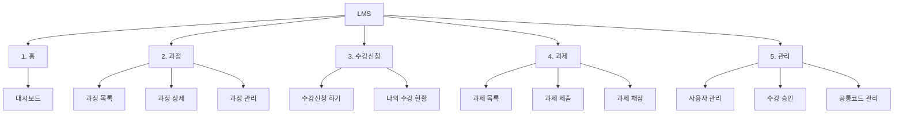

# LMS 메뉴구조도

## 1. 개요

- 대상: LMS 앱 (Flutter 클라이언트)
- 메뉴 구성: 대메뉴 5종 / 소메뉴 12개
- 접근 권한: 학습자(S), 강사(T), 관리자(A) — 권한에 따라 하단 탭과 메뉴 노출이 달라진다.
- 작성 상태: 4주차 초안 (v0.1)

## 2. 메뉴 구조도

## 3. 메뉴 상세

| 대메뉴 | 소메뉴 | 화면 ID | 설명 | 접근 권한 |
| --- | --- | --- | --- | --- |
| 1. 홈 | 대시보드 | LMS-H001 | 내 수강 과정, 마감 임박 과제, 공지 요약 | S, T, A |
| 2. 과정 | 과정 목록 | LMS-C001 | 과정 검색·조회 (이름, 상태, 기간) | S, T, A |
| 2. 과정 | 과정 상세 | LMS-C002 | 과정 정보, 강사, 정원, 신청 현황 | S, T, A |
| 2. 과정 | 과정 관리 | LMS-C003 | 과정 등록·수정·상태 변경 | T, A |
| 3. 수강신청 | 수강신청 하기 | LMS-E001 | 모집중 과정 신청·취소 | S |
| 3. 수강신청 | 나의 수강 현황 | LMS-E002 | 신청·승인·종료 상태별 내 과정 | S |
| 4. 과제 | 과제 목록 | LMS-A001 | 과정별 과제와 제출 상태 조회 | S, T |
| 4. 과제 | 과제 제출 | LMS-A002 | 내용 입력, 파일 첨부 후 제출 | S |
| 4. 과제 | 과제 채점 | LMS-A003 | 제출물 확인, 점수·피드백 입력 | T |
| 5. 관리 | 사용자 관리 | LMS-M001 | 사용자 등록·수정·권한 부여 | A |
| 5. 관리 | 수강 승인 | LMS-M002 | 신청 건 승인·반려 | A |
| 5. 관리 | 공통코드 관리 | LMS-M003 | 상태·역할 코드 관리 | A |

## 4. 화면 이동 흐름 (주요 시나리오)

- 학습자: 로그인 → 홈 → 과정 목록 → 과정 상세 → 수강신청 → 나의 수강 현황 → 과제 목록 → 과제 제출
- 강사: 로그인 → 홈 → 과정 관리(등록) → 과제 목록 → 과제 채점
- 관리자: 로그인 → 관리 → 수강 승인 → 사용자 관리

## 5. Flutter 화면 구성 메모

- 하단 탭(BottomNavigationBar)에 홈 · 과정 · 수강신청 · 과제를 두고, 관리 메뉴는 관리자에게만 노출한다.
- 화면 이동은 go\_router의 경로로 관리한다 (예: `/courses`, `/courses/:id`, `/admin/enrollments`).
- 화면 ID는 요구사항 정의서의 기능 ID(LMS-001~012)와 매핑하여 5주차 테이블 정의서까지 추적한다.
