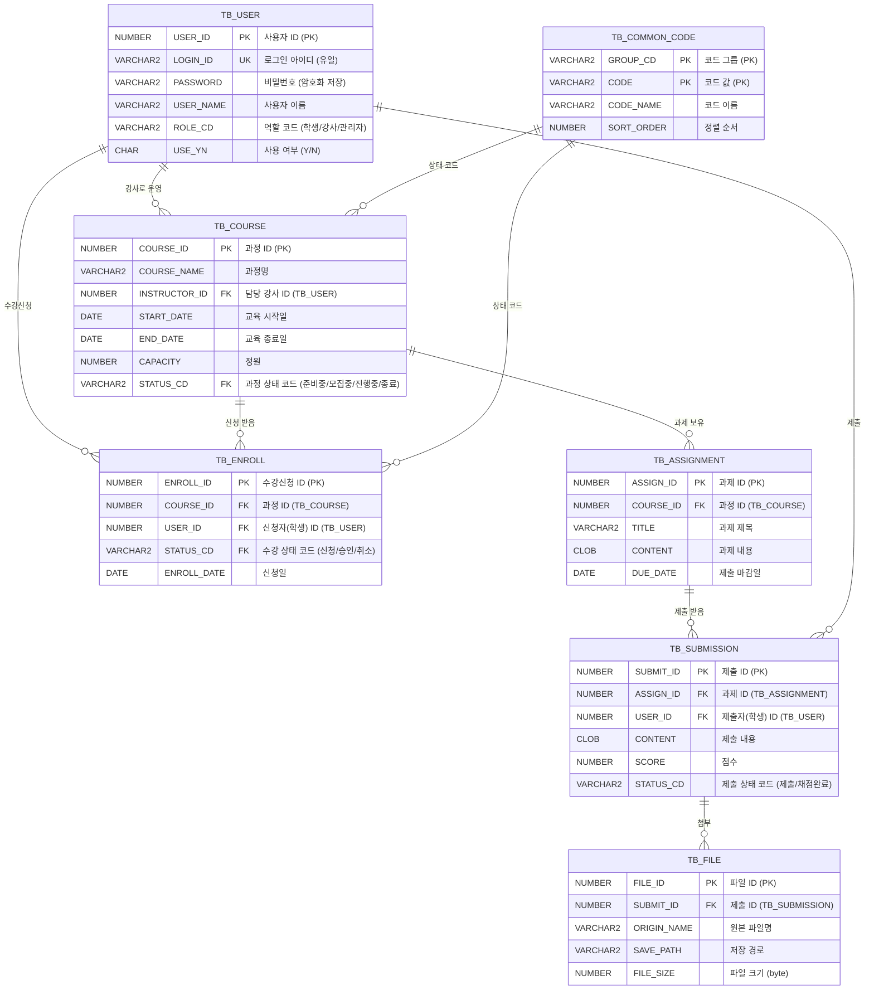

# LMS ERD

## 1. 개요

- 대상: LMS 핵심 업무 (사용자 · 과정 · 수강신청 · 과제 · 첨부파일 · 공통코드)
- DBMS: Oracle / 명명 규칙: 테이블 `TB_` 접두어, 컬럼은 대문자 SNAKE\_CASE
- 작성 상태: 4주차 초안 (v0.1)

## 2. ERD (논리 모델)

## 3. 테이블 목록

| 테이블명 | 한글명 | 설명 |
| --- | --- | --- |
| TB\_USER | 사용자 | 학습자·강사·관리자 계정 정보 |
| TB\_COURSE | 과정 | 교육과정 기본 정보, 담당 강사, 기간·정원 |
| TB\_ENROLL | 수강신청 | 사용자와 과정의 신청·승인 관계 |
| TB\_ASSIGNMENT | 과제 | 과정별 과제 출제 정보 |
| TB\_SUBMISSION | 과제 제출 | 학습자별 과제 제출·채점 결과 |
| TB\_FILE | 첨부파일 | 과제 제출 파일의 메타 정보 |
| TB\_COMMON\_CODE | 공통코드 | 역할, 과정 상태, 수강 상태 등 코드 |

## 4. 관계 정의

- 사용자(1) : 과정(N) — 강사 한 명이 여러 과정을 운영한다.
- 사용자(1) : 수강신청(N) : 과정(1) — 수강신청은 사용자와 과정의 N:M 관계를 풀어낸 테이블이다.
- 과정(1) : 과제(N) — 한 과정에 여러 과제가 있다.
- 과제(1) : 제출(N) — 학습자는 과제당 한 번 제출한다 (ASSIGN\_ID + USER\_ID 유일).
- 제출(1) : 첨부파일(N) — 제출물에 파일을 여러 개 첨부할 수 있다.

## 5. 설계 메모

- 상태값(과정, 수강, 제출)은 공통코드로 관리하여 하드코딩을 피한다.
- 수강신청은 (COURSE\_ID, USER\_ID) 복합 유일 제약으로 중복 신청을 막는다.
- 모든 테이블에 REG\_ID, REG\_DT, MOD\_ID, MOD\_DT 컬럼을 추가한다 (생략 표기).
- 상세 컬럼 정의는 5주차 "LMS 테이블 정의서"에서 작성한다.
