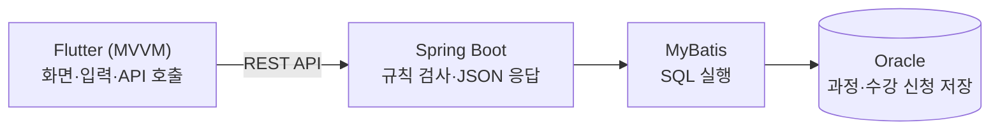

# 프로젝트 계획서 (1시간 미니판) — 답안

## 1. 목표와 범위
| 칸 | 내용 |
|---|---|
| 목표 (한 문장: 누가 무엇을 할 수 있게 된다) | 수강생이 앱에서 과정을 찾아 신청하고, 내 신청 내역을 확인할 수 있게 된다. |
| 만들 기능 1 | 수강생이 과정명으로 과정을 검색해 목록을 본다. |
| 만들 기능 2 | 수강생이 과정을 수강 신청한다. |
| 만들 기능 3 | 수강생이 내 수강 목록을 본다. |
| 안 만들 기능 1개 | 수강생이 수강료를 결제한다. (결제 연동은 이번 범위에서 뺀다) |

## 2. 계층별 역할
| 계층 | 역할 (한 줄) |
|---|---|
| Flutter (MVVM) | 화면을 보여 주고 입력을 받아 API를 부른다 (View는 화면, ViewModel은 상태와 API 호출 담당). |
| Spring Boot | REST API 요청을 받아 규칙(로그인 여부, 중복 신청)을 검사하고 결과를 JSON으로 돌려준다. |
| MyBatis | Spring Boot가 쓸 SQL을 실행해 Oracle과 데이터를 주고받는다. |
| Oracle | 과정(TB_COURSE)과 수강 신청(TB_ENROLL) 데이터를 저장한다. |

## 3. 위험과 대비책
| 위험 | 대비책 |
|---|---|
| Oracle 접속 설정이 늦어져 서버 개발이 멈춘다. | 1일차에 DB 접속 시험부터 하고, 실패하면 담당 강사에게 바로 알린다. |

## 4. 🖼 구성도

그림 설명: 그림 1. 미니 LMS 구성도 (앱 → 서버 → SQL → DB)

## 스스로 점검
- [x] ★ 만들 기능 3개·안 만들 기능 1개가 "누가 무엇을 한다" 형태다
- [x] ★ 계층 4개의 역할이 한 줄씩 있다
- [x] 목표에 "누가 무엇을 할 수 있게 된다"가 들어 있다
- [x] 🖼 구성도에 계층 4개와 화살표가 있고 이름이 2번 표와 같다
- [x] 위험 1개와 대비책 1개가 함께 있다
