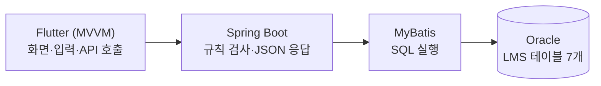

# LMS 프로젝트 계획서 (1시간 미니판) — 답안

## 1. 목표와 범위
| 칸 | 내용 |
|---|---|
| 목표 (한 문장: 누가 무엇을 할 수 있게 된다) | 학습자가 앱에서 과정을 찾아 수강신청하고, 관리자가 그 신청을 승인하거나 반려할 수 있게 된다. |
| 만들 기능 1 | 학습자가 과정을 이름·상태·기간으로 검색한다. (LMS-003) |
| 만들 기능 2 | 학습자가 모집중인 과정을 수강신청한다. (LMS-006) |
| 만들 기능 3 | 관리자가 수강신청을 승인·반려하고, 학습자가 승인 전 신청을 취소한다. (LMS-007) |
| 안 만들 기능 1개 | 학습자가 수강료를 결제한다. (요구사항 정의서 5번에서 결제·외부 연동 제외) |

## 2. 계층별 역할
| 계층 | 역할 (한 줄) |
|---|---|
| Flutter (MVVM) | 화면을 보여 주고 입력을 받아 API를 부른다 (View는 화면, ViewModel은 상태와 API 호출 담당). |
| Spring Boot | REST API 요청을 받아 규칙(권한, 중복 신청, 정원)을 검사하고 결과를 JSON으로 돌려준다. |
| MyBatis | Spring Boot가 쓸 SQL을 실행해 Oracle과 데이터를 주고받는다. |
| Oracle | 사용자(USERS)·과정(COURSE)·수강신청(ENROLL)·공통코드(COMMON_CODE) 등 7개 테이블에 데이터를 저장한다. |

## 3. 위험과 대비책
| 위험 | 대비책 |
|---|---|
| 실제 DDL에 중복 신청을 막는 UNIQUE 제약이 없어 같은 과정이 두 번 신청될 수 있다. | 1일차에 ENROLL (COURSE_ID, USER_ID) UNIQUE를 추가하고, 서비스 코드에서도 신청 전에 확인한다. |

## 4. 🖼 구성도

그림 설명: 그림 1. LMS 구성도 (앱 → REST API 서버 → SQL → DB)

## 스스로 점검
- [x] ★ 만들 기능 3개·안 만들 기능 1개가 "누가 무엇을 한다" 형태다
- [x] ★ 계층 4개의 역할이 한 줄씩 있다
- [x] 목표에 "누가 무엇을 할 수 있게 된다"가 들어 있다
- [x] 🖼 구성도에 계층 4개와 화살표가 있고 이름이 2번 표와 같다
- [x] 위험 1개와 대비책 1개가 함께 있다
