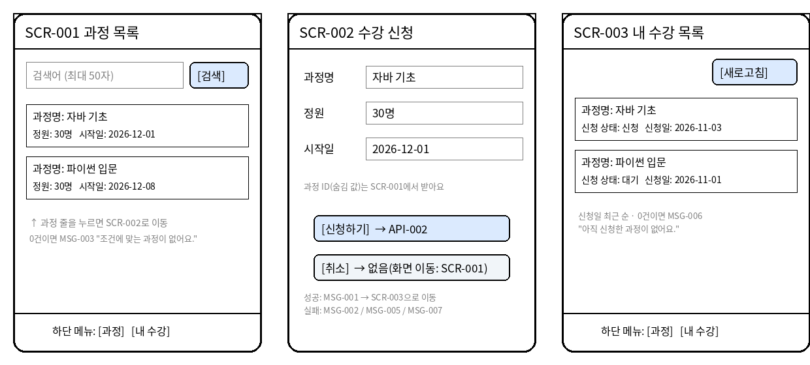

# 화면 설계서 (1시간 미니판) — 답안

## 1. 화면 목록
| 화면 ID   | 화면 이름   | 관련 FR  | 입력칸/버튼            | 필수·규칙                    | 누르면 → 호출 API ID    |
| ------- | ------- | ------ | ----------------- | ------------------------ | ------------------ |
| SCR-001 | 과정 목록   | FR-001 | 검색어 입력칸 + [검색] 버튼 | 선택 입력, 최대 50자            | API-001            |
| SCR-002 | 수강 신청   | FR-002 | [신청하기] 버튼         | 과정 ID 필수 (SCR-001에서 넘어옴) | API-002            |
| SCR-002 | 수강 신청   | FR-002 | [취소] 버튼           | 입력 없음                    | 없음(화면 이동: SCR-001) |
| SCR-003 | 내 수강 목록 | FR-003 | [새로고침] 버튼         | 입력 없음                    | API-003            |

## 2. 메시지
| 칸      | 문장 (화면에 그대로 띄울 문장) |
| ------ | ------------------ |
| 성공 메시지 | 수강 신청이 완료되었어요.     |
| 오류 메시지 | 이미 신청한 과정이에요.      |

## 3. 🖼 화면 스케치

그림 설명: 그림 3. SCR-002 수강 신청 화면

## 스스로 점검
- [x] ★ 화면 3개 모두 관련 FR 번호가 있다
- [x] ★ 버튼마다 호출 API ID가 있다 (화면 이동은 "없음(화면 이동)")
- [x] 입력칸마다 필수 여부와 검사 규칙이 있다
- [x] 🖼 스케치 속 입력칸·버튼 이름이 1번 표와 같다
- [x] 메시지가 화면에 그대로 띄울 완성된 문장이다
