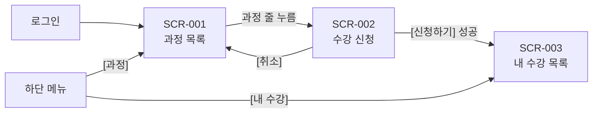

# 화면 설계서 (1시간 미니판) — 답안

## 0. 개정 이력
| 버전 | 날짜 | 작성자 | 바꾼 내용 |
|---|---|---|---|
| v1.0 | 2026-11-05 | 답안지(가상) | 처음 작성 |

## 1. 🖼 메뉴 구조·화면 흐름

## 2. 화면 목록
| 화면 ID | 화면 이름 | 설명 (한 줄) | 관련 FR | 들어오는 길 | 관리자 | 강사 | 수강생 |
|---|---|---|---|---|---|---|---|
| SCR-001 | 과정 목록 | 개설된 과정을 검색하고 고르는 화면 | FR-001 | 로그인 후 첫 화면, 하단 메뉴 [과정] | O | O | O |
| SCR-002 | 수강 신청 | 고른 과정 정보를 확인하고 신청하는 화면 | FR-002 | SCR-001에서 과정 줄을 누름 | X | X | O |
| SCR-003 | 내 수강 목록 | 내가 신청한 과정과 상태를 보는 화면 | FR-003 | 하단 메뉴 [내 수강], SCR-002 신청 성공 후 | X | X | O |

## 3. 🖼 화면 스케치

그림 설명: 그림 3. SCR-001·002·003 화면 스케치

## 4. 입력 항목
| 화면 ID | 항목 이름 | 종류 (글자 입력 / 선택 / 숨김 값 등) | 필수 | 길이·형식 | 기본값 | 검사 규칙 | 규칙에 안 맞을 때 메시지 ID |
|---|---|---|---|---|---|---|---|
| SCR-001 | 검색어 | 글자 입력 | 선택 | 최대 50자 | 빈 값 (전체 조회) | 앞뒤 공백을 지우고, 50자를 넘으면 검색하지 않음 | MSG-004 |
| SCR-002 | 과정 ID | 숨김 값 | 필수 | 숫자, 10자리 이하 | SCR-001에서 받은 값 | 값이 없으면 신청하지 않고 SCR-001로 돌아감 | MSG-007 |

## 5. 출력 항목
| 화면 ID | 항목 이름 | 보이는 형식 (예: yyyy-MM-dd, "30명") | 값을 가져오는 곳 (API 응답 필드 ← 테이블.컬럼) |
|---|---|---|---|
| SCR-001 | 과정명 | 글자 그대로 | API-001 courseNm ← TB_COURSE.COURSE_NM |
| SCR-001 | 정원 | 숫자 + "명" (예: 30명) | API-001 capacity ← TB_COURSE.CAPACITY |
| SCR-001 | 시작일 | yyyy-MM-dd | API-001 startDt ← TB_COURSE.START_DT |
| SCR-002 | 과정명·정원·시작일 | SCR-001과 같음 | SCR-001에서 넘겨받은 값 (API-001 결과) |
| SCR-003 | 과정명 | 글자 그대로 | API-003 courseNm ← TB_COURSE.COURSE_NM |
| SCR-003 | 신청 상태 | 코드 이름 (01 → 신청, 02 → 대기, 03 → 취소) | API-003 enrollStatCd ← TB_ENROLL.ENROLL_STAT_CD (공통코드 ENROLL_STAT) |
| SCR-003 | 신청일 | yyyy-MM-dd | API-003 enrollDt ← TB_ENROLL.ENROLL_DT |

## 6. 이벤트
| 화면 ID | 이벤트 | 처리 내용 | 호출 API ID | 성공하면 | 실패하면 (메시지 ID) |
|---|---|---|---|---|---|
| SCR-001 | 화면 열림 | 검색어 없이 전체 과정 조회 | API-001 | 목록 표시 (0건이면 MSG-003) | MSG-005, MSG-007 |
| SCR-001 | [검색] 버튼 | 검색어로 과정 조회 | API-001 | 목록 표시 (0건이면 MSG-003) | MSG-004, MSG-005, MSG-007 |
| SCR-001 | 과정 줄 누름 | 고른 과정 정보를 들고 이동 | 없음(화면 이동) | SCR-002로 이동 | - |
| SCR-002 | [신청하기] 버튼 | 수강 신청 저장 | API-002 | MSG-001 띄우고 SCR-003으로 이동 | MSG-002, MSG-005, MSG-007 |
| SCR-002 | [취소] 버튼 | 신청하지 않고 돌아감 | 없음(화면 이동) | SCR-001로 이동 | - |
| SCR-003 | 화면 열림 / [새로고침] 버튼 | 내 수강 목록 조회 | API-003 | 신청일 최근 순으로 목록 표시 (0건이면 MSG-006) | MSG-005, MSG-007 |

## 7. 메시지
| 메시지 ID | 종류 (성공 / 오류 / 안내) | 문장 (화면에 그대로 띄울 문장) | 쓰는 화면 |
|---|---|---|---|
| MSG-001 | 성공 | 수강 신청이 완료되었어요. | SCR-002 |
| MSG-002 | 오류 | 이미 신청한 과정이에요. | SCR-002 |
| MSG-003 | 안내 | 조건에 맞는 과정이 없어요. | SCR-001 |
| MSG-004 | 오류 | 검색어는 50자까지 입력할 수 있어요. | SCR-001 |
| MSG-005 | 오류 | 로그인이 필요해요. | 전체 |
| MSG-006 | 안내 | 아직 신청한 과정이 없어요. | SCR-003 |
| MSG-007 | 오류 | 잠시 후 다시 시도해 주세요. | 전체 |

## 스스로 점검
- [x] ★ 화면 3개 모두 이름·설명·관련 FR·들어오는 길이 있다
- [x] 🖼 메뉴 흐름에 화면 3개와 이동 화살표가 모두 있다
- [x] 🖼 ★ 화면 3개 스케치가 있고 칸·버튼 이름이 표와 같다
- [x] ★ 입력 항목마다 8칸이 채워져 있다
- [x] 출력 항목마다 형식과 값을 가져오는 곳이 있다
- [x] ★ 이벤트마다 처리 내용·API·성공하면·실패하면이 있다
- [x] 메시지마다 ID·종류·문장·쓰는 화면이 있고 빈 목록 안내가 있다
- [x] 화면마다 관리자·강사·수강생 접근이 O/X로 있다
- [x] 개정 이력에 버전·날짜·작성자·바꾼 내용이 있다
