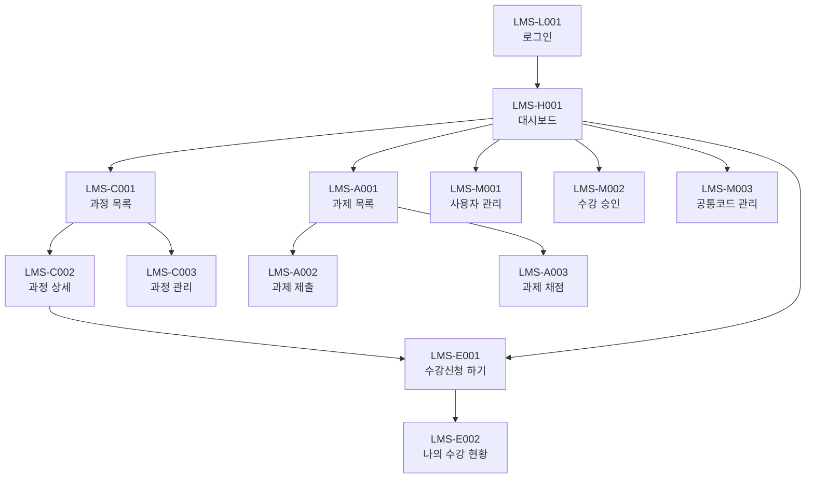

# LMS 화면 설계서 (1시간 미니판) — 답안

> 실제 메뉴구조도(`03 프로젝트 산출물/LMS 메뉴구조도.md`) 기준. 화면 13개(메뉴 12개 + 로그인)를 모두 담았어요.
> 자세히 적은 화면(5~9번)은 답안 기능 3개(LMS-003 과정 목록 조회, LMS-006 수강신청, LMS-007 수강 승인/취소)에 쓰는 LMS-C001·E001·E002·M002예요.

## 0. 개정 이력
| 버전 | 날짜 | 작성자 | 바꾼 내용 |
|---|---|---|---|
| v1.0 | 2026-11-05 | 답안지 | 실제 메뉴구조도 기준으로 작성 |

## 1. 화면 목록 (13개)
| 화면 ID | 화면 이름 | 설명 | 관련 요구사항 | 진입 경로 | 학습자 | 강사 | 관리자 |
|---|---|---|---|---|---|---|---|
| LMS-L001 | 로그인 | 아이디·비밀번호로 로그인 | LMS-001 | 앱 시작, 로그아웃 후 | O | O | O |
| LMS-H001 | 대시보드 | 내 수강 과정·마감 임박 과제·공지 요약 | LMS-006, LMS-009 (조회) | 로그인 성공 후, 하단 탭 [홈] | O | O | O |
| LMS-C001 | 과정 목록 | 과정을 이름·상태·기간으로 검색 | LMS-003 | 하단 탭 [과정] | O | O | O |
| LMS-C002 | 과정 상세 | 과정 정보·강사·정원·신청 현황 | LMS-003, LMS-012 | C001에서 과정 줄을 누름 | O | O | O |
| LMS-C003 | 과정 관리 | 과정 등록·수정·상태 변경 | LMS-004, LMS-005 | [과정] 메뉴 → 과정 관리 (강사·관리자) | X | O | O |
| LMS-E001 | 수강신청 하기 | 모집중 과정 신청·취소 | LMS-006, LMS-007 | 하단 탭 [수강신청], C002의 [수강신청] 버튼 | O | X | X |
| LMS-E002 | 나의 수강 현황 | 신청·승인·반려 상태별 내 과정 | LMS-006, LMS-007 | [수강신청] 메뉴 → 나의 수강 현황, E001 신청 성공 후 | O | X | X |
| LMS-A001 | 과제 목록 | 과정별 과제와 제출 상태 | LMS-008, LMS-009 | 하단 탭 [과제] | O | O | X |
| LMS-A002 | 과제 제출 | 내용 입력·파일 첨부 후 제출 | LMS-009 | A001에서 과제를 누름 (학습자) | O | X | X |
| LMS-A003 | 과제 채점 | 제출물 확인·점수·피드백 입력 | LMS-010 | A001에서 과제를 누름 (강사) | X | O | X |
| LMS-M001 | 사용자 관리 | 사용자 등록·수정·권한 부여 | LMS-002 | [관리] 메뉴 → 사용자 관리 (관리자) | X | X | O |
| LMS-M002 | 수강 승인 | 신청 건 승인·반려 | LMS-007, LMS-012 | [관리] 메뉴 → 수강 승인 (관리자) | X | X | O |
| LMS-M003 | 공통코드 관리 | 상태·역할 코드 관리 | LMS-011 | [관리] 메뉴 → 공통코드 관리 (관리자) | X | X | O |

※ 로그인 화면은 메뉴구조도에 화면 ID가 없어서 `LMS-L001`을 새로 붙였어요.

## 2. 🖼 메뉴 구조·화면 흐름

## 3. 화면 이동
| 출발 화면    | 도착 화면    | 이동 조건 (버튼·메뉴·권한)      |
| -------- | -------- | --------------------- |
| LMS-L001 | LMS-H001 | 로그인 성공                |
| LMS-H001 | LMS-C001 | 하단 탭 [과정]             |
| LMS-C001 | LMS-C002 | 과정 줄을 누름              |
| LMS-C001 | LMS-C003 | [과정 관리] (강사·관리자만 보임)  |
| LMS-C002 | LMS-E001 | [수강신청] 버튼 (학습자)       |
| LMS-H001 | LMS-E001 | 하단 탭 [수강신청]           |
| LMS-E001 | LMS-E002 | 신청 성공 / [나의 수강 현황] 메뉴 |
| LMS-H001 | LMS-A001 | 하단 탭 [과제]             |
| LMS-A001 | LMS-A002 | 과제를 누름 (학습자)          |
| LMS-A001 | LMS-A003 | 과제를 누름 (강사)           |
| LMS-H001 | LMS-M001 | [관리] → 사용자 관리 (관리자)   |
| LMS-H001 | LMS-M002 | [관리] → 수강 승인 (관리자)    |
| LMS-H001 | LMS-M003 | [관리] → 공통코드 관리 (관리자)  |

## 4. 빠진 화면 찾기
| 요구사항 | 왜 화면이 없다고 보나 | 어떻게 하면 좋을까 |
|---|---|---|
| LMS-008 과제 출제 | 메뉴구조도의 과제 메뉴는 목록·제출·채점뿐이고 출제(등록) 화면이 없음 | 과제 목록(A001)에 강사용 [과제 등록] 버튼과 과제 등록 화면(예: LMS-A004)을 더함 |
| LMS-001 로그아웃 | 로그아웃 버튼이 어느 화면에 있는지 적혀 있지 않음 | 메인 레이아웃(앱바)에 [로그아웃]을 두고 화면 설계서에 적음 |

## 5. 🖼 화면 스케치

그림 설명: 그림 3. LMS-C001·E001·E002·M002 화면 스케치

## 6. 입력 항목
| 화면 ID | 항목 | 종류 | 필수 | 길이·형식 | 기본값 | 검사 규칙 | 오류 메시지 |
|---|---|---|---|---|---|---|---|
| LMS-C001 | 과정명 검색어 | 글자 입력 | 선택 | 최대 100자 (COURSE_NAME 길이) | 빈 값 (전체) | 앞뒤 공백을 지움 | - |
| LMS-C001 | 상태 | 선택 (드롭다운) | 선택 | 공통코드 COURSE_STATUS | 전체 | 공통코드에 있는 값만 | - |
| LMS-C001 | 기간 (시작일~종료일) | 날짜 선택 | 선택 | yyyy-MM-dd | 빈 값 | 시작일이 종료일보다 늦으면 검색 안 함 | MSG-010 |
| LMS-E002 | 상태 필터 | 선택 (칩) | 선택 | 공통코드 ENROLL_STATUS | 전체 | 공통코드에 있는 값만 | - |
| LMS-M002 | 상태 필터 | 선택 (칩) | 선택 | 공통코드 ENROLL_STATUS | 10 (신청) | 공통코드에 있는 값만 | - |

## 7. 출력 항목
| 화면 ID | 항목 | 보이는 형식 | 값 출처 (API 필드 ← 테이블.컬럼) |
|---|---|---|---|
| LMS-C001 | 과정명 | 글자 그대로 | API-001 courseName ← COURSE.COURSE_NAME |
| LMS-C001 | 강사 이름 | 글자 그대로 | API-001 instructorName ← USERS.USER_NAME (COURSE.INSTRUCTOR_ID로 연결) |
| LMS-C001 | 교육 기간 | yyyy-MM-dd ~ yyyy-MM-dd | API-001 startDate, endDate ← COURSE.START_DATE, END_DATE |
| LMS-C001 | 정원 | 숫자 + "명" | API-001 capacity ← COURSE.CAPACITY |
| LMS-C001 | 상태 뱃지 | 코드 이름 (예: 모집중) | API-001 statusCd ← COURSE.STATUS_CD → COMMON_CODE.CODE_NAME |
| LMS-E001 | 모집중 과정 카드 (과정명·기간·정원·상태) | C001과 같음 | API-001 (statusCd=20) |
| LMS-E001 | 내 신청 처리 상태 | 코드 이름 (신청/승인/반려) | API-003 statusCd ← ENROLL.STATUS_CD → COMMON_CODE.CODE_NAME |
| LMS-E002 | 과정명 | 글자 그대로 | API-003 courseName ← COURSE.COURSE_NAME |
| LMS-E002 | 신청일 | yyyy-MM-dd | API-003 enrollDate ← ENROLL.ENROLL_DATE |
| LMS-E002 | 처리 상태 | 코드 이름 (신청/승인/반려) | API-003 statusCd ← ENROLL.STATUS_CD → COMMON_CODE.CODE_NAME |
| LMS-M002 | 신청자 이름 | 글자 그대로 | API-004 userName ← USERS.USER_NAME |
| LMS-M002 | 과정명 | 글자 그대로 | API-004 courseName ← COURSE.COURSE_NAME |
| LMS-M002 | 신청일 | yyyy-MM-dd | API-004 enrollDate ← ENROLL.ENROLL_DATE |
| LMS-M002 | 처리 상태 | 코드 이름 | API-004 statusCd ← ENROLL.STATUS_CD → COMMON_CODE.CODE_NAME |

## 8. 이벤트
| 화면 ID | 이벤트 | 처리 내용 | API | 성공하면 | 실패하면 |
|---|---|---|---|---|---|
| LMS-C001 | 화면 열림 | 전체 과정 1쪽(10건) 조회 | API-001 | 목록 표시 (0건이면 MSG-004) | MSG-011, MSG-013 |
| LMS-C001 | [검색] 버튼 | 검색어·상태·기간으로 조회 | API-001 | 목록 표시 (0건이면 MSG-004) | MSG-010, MSG-013 |
| LMS-C001 | 목록 끝까지 내림 | 다음 쪽 10건 더 조회 | API-001 | 목록 아래에 붙여 표시 | MSG-013 |
| LMS-C001 | 과정 줄을 누름 | 과정 ID를 들고 이동 | 없음(화면 이동) | LMS-C002로 이동 | - |
| LMS-E001 | 화면 열림 | 모집중(20) 과정과 내 신청 조회 | API-001, API-003 | 카드 표시 (0건이면 MSG-004) | MSG-011, MSG-013 |
| LMS-E001 | [신청] 버튼 | 수강신청 저장 | API-002 | MSG-001 띄우고 LMS-E002로 이동 | MSG-002, MSG-003, MSG-015, MSG-013 |
| LMS-E001 | [신청 취소] 버튼 | MSG-006으로 묻고 신청 삭제 | API-006 | MSG-007, 카드 다시 조회 | MSG-008, MSG-013 |
| LMS-E002 | 화면 열림 / 상태 필터 바꿈 | 내 신청 목록 조회 (신청일 최근 순) | API-003 | 목록 표시 (0건이면 MSG-005) | MSG-011, MSG-013 |
| LMS-E002 | [신청 취소] 버튼 (신청 상태일 때만 보임) | MSG-006으로 묻고 신청 삭제 | API-006 | MSG-007, 목록 다시 조회 | MSG-008, MSG-013 |
| LMS-M002 | 화면 열림 / 상태 필터 바꿈 | 신청 건 목록 조회 | API-004 | 목록 표시 (0건이면 MSG-014) | MSG-012, MSG-013 |
| LMS-M002 | [승인] 버튼 | 상태를 20(승인)으로 변경 | API-005 | MSG-009, 목록 다시 조회 | MSG-003, MSG-012, MSG-013 |
| LMS-M002 | [반려] 버튼 | 상태를 30(반려)으로 변경 | API-005 | MSG-009, 목록 다시 조회 | MSG-012, MSG-013 |

## 9. 메시지
| 메시지 ID | 종류 | 문장 | 쓰는 화면 |
|---|---|---|---|
| MSG-001 | 성공 | 수강신청이 완료되었어요. | LMS-E001 |
| MSG-002 | 오류 | 이미 신청한 과정이에요. | LMS-E001 |
| MSG-003 | 오류 | 정원이 다 찼어요. | LMS-E001, LMS-M002 |
| MSG-004 | 안내 | 조건에 맞는 과정이 없어요. | LMS-C001, LMS-E001 |
| MSG-005 | 안내 | 아직 신청한 과정이 없어요. | LMS-E002 |
| MSG-006 | 확인 | 신청을 취소할까요? | LMS-E001, LMS-E002 |
| MSG-007 | 성공 | 신청을 취소했어요. | LMS-E001, LMS-E002 |
| MSG-008 | 오류 | 승인 전 신청만 취소할 수 있어요. | LMS-E001, LMS-E002 |
| MSG-009 | 성공 | 처리했어요. | LMS-M002 |
| MSG-010 | 오류 | 시작일이 종료일보다 늦어요. | LMS-C001 |
| MSG-011 | 오류 | 로그인이 필요해요. | 전체 |
| MSG-012 | 오류 | 권한이 없어요. | LMS-M002 |
| MSG-013 | 오류 | 잠시 후 다시 시도해 주세요. | 전체 |
| MSG-014 | 안내 | 처리할 신청이 없어요. | LMS-M002 |
| MSG-015 | 오류 | 모집중인 과정만 신청할 수 있어요. | LMS-E001 |

## 스스로 점검
- [x] ★ 화면 13개 모두 설명·관련 요구사항·진입 경로가 있다
- [x] 🖼 메뉴 흐름에서 화면 13개가 모두 화살표로 이어져 있다
- [x] 화면 이동 표에 화살표마다 이동 조건이 있다
- [x] 화면이 없는 요구사항을 찾아 적었다
- [x] 🖼 ★ 기능 3개에 쓰는 화면이 모두 스케치에 있다
- [x] ★ 입력 항목마다 8칸이 채워져 있다
- [x] 출력 항목마다 형식과 값 출처가 있다
- [x] ★ 이벤트마다 처리 내용·API·성공하면·실패하면이 있다
- [x] 메시지마다 ID·종류·문장·쓰는 화면이 있고 빈 목록 안내가 있다
- [x] 개정 이력에 버전·날짜·작성자·바꾼 내용이 있다
