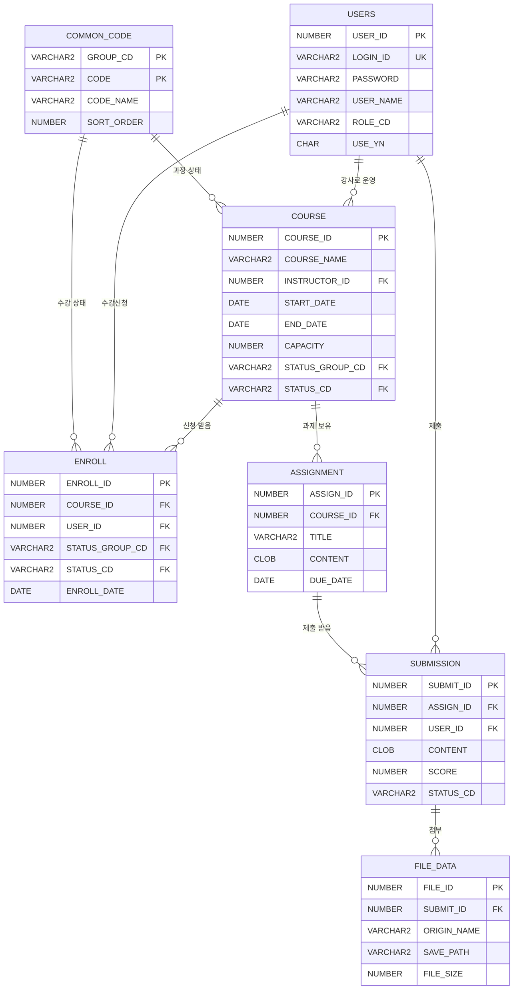

# LMS 테이블 정의서 (1시간 미니판) — 답안

> 실제 DDL(`03 프로젝트 산출물/LMS/LMS 테이블 정의서.md`) 기준. 테이블 7개 · 컬럼 40개 · FK 9개 · 공통코드 13개를 모두 담았어요.

## 0. 개정 이력
| 버전 | 날짜 | 작성자 | 바꾼 내용 |
|---|---|---|---|
| v1.0 | 2026-11-05 | 답안지 | 실제 DDL 기준으로 작성 |

## 1. 테이블 목록 (7개)
| 테이블 | 한글 이름 | 무엇을 저장하나 | 관련 요구사항 |
|---|---|---|---|
| USERS | 사용자 | 학습자·강사·관리자 계정과 역할 | LMS-001, LMS-002 |
| COURSE | 과정 | 과정 이름·담당 강사·기간·정원·상태 | LMS-003, LMS-004, LMS-005 |
| ENROLL | 수강신청 | 누가 어느 과정을 신청했고 처리 상태가 무엇인지 | LMS-006, LMS-007, LMS-012 |
| ASSIGNMENT | 과제 | 과정별 과제 제목·내용·마감일 | LMS-008 |
| SUBMISSION | 과제 제출 | 학습자별 제출 내용·점수·상태 | LMS-009, LMS-010 |
| FILE_DATA | 첨부파일 | 제출에 붙은 파일의 이름·경로·크기 | LMS-009 |
| COMMON_CODE | 공통코드 | 역할·과정 상태·수강 상태·제출 상태 코드 | LMS-011 |

## 2. 컬럼 정의 (40개)
| 테이블 | 컬럼 | 한글 이름 | 종류 | 길이 | PK/UK | FK (참조) | NULL | 기본값 | 개인정보 | 설명 |
|---|---|---|---|---|---|---|---|---|---|---|
| USERS | USER_ID | 사용자 ID | NUMBER | - | PK | - | N | - | N | 사용자를 구분하는 번호 |
| USERS | LOGIN_ID | 로그인 아이디 | VARCHAR2 | 50 | UK | - | Y | - | Y | 로그인할 때 쓰는 아이디 (UK로 중복 막음) |
| USERS | PASSWORD | 비밀번호 | VARCHAR2 | 100 | - | - | Y | - | Y | 비밀번호. 해시로 저장해야 함 (지금 데이터는 평문 — 개선 2) |
| USERS | USER_NAME | 사용자 이름 | VARCHAR2 | 50 | - | - | Y | - | Y | 화면에 보이는 이름 |
| USERS | ROLE_CD | 역할 코드 | VARCHAR2 | 10 | - | - | Y | - | N | 공통코드 ROLE (S 학습자 / T 강사 / A 관리자) |
| USERS | USE_YN | 사용 여부 | CHAR | 1 | - | - | Y | - | N | Y 사용, N 비활성 (LMS-002 비활성화) |
| COURSE | COURSE_ID | 과정 ID | NUMBER | - | PK | - | N | - | N | 과정을 구분하는 번호 |
| COURSE | COURSE_NAME | 과정명 | VARCHAR2 | 100 | - | - | Y | - | N | 화면에 보이는 과정 이름 (검색 대상) |
| COURSE | INSTRUCTOR_ID | 담당 강사 ID | NUMBER | - | - | USERS.USER_ID | Y | - | N | 과정을 맡은 강사 (USERS) |
| COURSE | START_DATE | 교육 시작일 | DATE | - | - | - | Y | - | N | 교육이 시작하는 날 |
| COURSE | END_DATE | 교육 종료일 | DATE | - | - | - | Y | - | N | 교육이 끝나는 날 |
| COURSE | CAPACITY | 정원 | NUMBER | - | - | - | Y | - | N | 받을 수 있는 최대 인원 |
| COURSE | STATUS_GROUP_CD | 상태 코드 그룹 | VARCHAR2 | 20 | - | COMMON_CODE.GROUP_CD (복합) | Y | - | N | 항상 COURSE_STATUS (공통코드 FK용) |
| COURSE | STATUS_CD | 과정 상태 코드 | VARCHAR2 | 10 | - | COMMON_CODE.CODE (복합) | Y | - | N | 공통코드 COURSE_STATUS (10 준비중 ~ 50 폐강) |
| ENROLL | ENROLL_ID | 수강신청 ID | NUMBER | - | PK | - | N | - | N | 신청 1건을 구분하는 번호 |
| ENROLL | COURSE_ID | 과정 ID | NUMBER | - | - | COURSE.COURSE_ID | Y | - | N | 신청한 과정 (COURSE) |
| ENROLL | USER_ID | 신청자 ID | NUMBER | - | - | USERS.USER_ID | Y | - | N | 신청한 학습자 (USERS) |
| ENROLL | STATUS_GROUP_CD | 상태 코드 그룹 | VARCHAR2 | 20 | - | COMMON_CODE.GROUP_CD (복합) | Y | - | N | 항상 ENROLL_STATUS (공통코드 FK용) |
| ENROLL | STATUS_CD | 수강 상태 코드 | VARCHAR2 | 10 | - | COMMON_CODE.CODE (복합) | Y | - | N | 공통코드 ENROLL_STATUS (10 신청 / 20 승인 / 30 반려) |
| ENROLL | ENROLL_DATE | 신청일 | DATE | - | - | - | Y | - | N | 신청한 날짜 |
| ASSIGNMENT | ASSIGN_ID | 과제 ID | NUMBER | - | PK | - | N | - | N | 과제를 구분하는 번호 |
| ASSIGNMENT | COURSE_ID | 과정 ID | NUMBER | - | - | COURSE.COURSE_ID | Y | - | N | 과제가 속한 과정 (COURSE) |
| ASSIGNMENT | TITLE | 과제 제목 | VARCHAR2 | 200 | - | - | Y | - | N | 과제 목록에 보이는 제목 |
| ASSIGNMENT | CONTENT | 과제 내용 | CLOB | - | - | - | Y | - | N | 과제 설명 (긴 글이라 CLOB) |
| ASSIGNMENT | DUE_DATE | 제출 마감일 | DATE | - | - | - | Y | - | N | 이날까지 제출해야 함 |
| SUBMISSION | SUBMIT_ID | 제출 ID | NUMBER | - | PK | - | N | - | N | 제출 1건을 구분하는 번호 |
| SUBMISSION | ASSIGN_ID | 과제 ID | NUMBER | - | - | ASSIGNMENT.ASSIGN_ID | Y | - | N | 제출한 과제 (ASSIGNMENT) |
| SUBMISSION | USER_ID | 제출자 ID | NUMBER | - | - | USERS.USER_ID | Y | - | N | 제출한 학습자 (USERS) |
| SUBMISSION | CONTENT | 제출 내용 | CLOB | - | - | - | Y | - | Y | 학습자가 쓴 답 (개인이 쓴 글이라 본인·강사만 봄) |
| SUBMISSION | SCORE | 점수 | NUMBER | - | - | - | Y | - | N | 채점 점수 (채점 전에는 비어 있음) |
| SUBMISSION | STATUS_CD | 제출 상태 코드 | VARCHAR2 | 10 | - | - | Y | - | N | 공통코드 SUBMIT_STATUS (10 제출 / 20 채점완료). FK 없음 — 개선 5 |
| FILE_DATA | FILE_ID | 파일 ID | NUMBER | - | PK | - | N | - | N | 첨부파일을 구분하는 번호 |
| FILE_DATA | SUBMIT_ID | 제출 ID | NUMBER | - | - | SUBMISSION.SUBMIT_ID | Y | - | N | 파일이 붙은 제출 (SUBMISSION) |
| FILE_DATA | ORIGIN_NAME | 원본 파일명 | VARCHAR2 | 255 | - | - | Y | - | N | 사용자가 올린 파일 이름 |
| FILE_DATA | SAVE_PATH | 저장 경로 | VARCHAR2 | 500 | - | - | Y | - | N | 서버에 저장된 위치 |
| FILE_DATA | FILE_SIZE | 파일 크기 | NUMBER | - | - | - | Y | - | N | byte 단위 |
| COMMON_CODE | GROUP_CD | 코드 그룹 | VARCHAR2 | 20 | PK | - | N | - | N | ROLE, COURSE_STATUS, ENROLL_STATUS, SUBMIT_STATUS |
| COMMON_CODE | CODE | 코드 값 | VARCHAR2 | 10 | PK | - | N | - | N | 그룹 안에서 구분하는 값 |
| COMMON_CODE | CODE_NAME | 코드 이름 | VARCHAR2 | 50 | - | - | Y | - | N | 화면에 보이는 이름 |
| COMMON_CODE | SORT_ORDER | 정렬 순서 | NUMBER | - | - | - | Y | - | N | 목록·드롭다운에 보이는 순서 |

## 3. 🖼 ERD

그림 설명: 그림 2. LMS 실제 ERD (테이블 7개, 관계 9개)

## 4. 관계 (FK 9개)
| 부모 (1) | 자식 (N) | 연결 컬럼 (FK) | 부모 행을 지우면 |
|---|---|---|---|
| USERS | COURSE | COURSE.INSTRUCTOR_ID → USERS.USER_ID | 맡은 과정이 있으면 지울 수 없음 |
| COMMON_CODE | COURSE | COURSE.(STATUS_GROUP_CD, STATUS_CD) → COMMON_CODE.(GROUP_CD, CODE) | 쓰는 과정이 있으면 지울 수 없음 |
| COURSE | ENROLL | ENROLL.COURSE_ID → COURSE.COURSE_ID | 신청이 있으면 지울 수 없음 |
| USERS | ENROLL | ENROLL.USER_ID → USERS.USER_ID | 신청이 있으면 지울 수 없음 (그래서 USE_YN으로 비활성화) |
| COMMON_CODE | ENROLL | ENROLL.(STATUS_GROUP_CD, STATUS_CD) → COMMON_CODE.(GROUP_CD, CODE) | 쓰는 신청이 있으면 지울 수 없음 |
| COURSE | ASSIGNMENT | ASSIGNMENT.COURSE_ID → COURSE.COURSE_ID | 과제가 있으면 지울 수 없음 |
| ASSIGNMENT | SUBMISSION | SUBMISSION.ASSIGN_ID → ASSIGNMENT.ASSIGN_ID | 제출이 있으면 지울 수 없음 |
| USERS | SUBMISSION | SUBMISSION.USER_ID → USERS.USER_ID | 제출이 있으면 지울 수 없음 |
| SUBMISSION | FILE_DATA | FILE_DATA.SUBMIT_ID → SUBMISSION.SUBMIT_ID | 첨부파일이 있으면 지울 수 없음 |

(모든 FK에 ON DELETE 옵션이 없어서, Oracle 기본 동작대로 자식이 있으면 부모를 지울 수 없어요.)

## 5. 공통코드 (실제 데이터 13개)
쓰는 화면은 `LMS 메뉴구조도.md`, `공통코드 화면별 적용 현황.md` 기준이에요.

| 코드 그룹 | 코드 값 | 코드 이름 | 쓰는 컬럼 | 쓰는 화면 |
|---|---|---|---|---|
| ROLE | S | 학생 | USERS.ROLE_CD | LMS-H001, LMS-M001, 메인 레이아웃 |
| ROLE | T | 강사 | USERS.ROLE_CD | LMS-H001, LMS-M001, 메인 레이아웃 |
| ROLE | A | 관리자 | USERS.ROLE_CD | LMS-H001, LMS-M001, 메인 레이아웃 |
| COURSE_STATUS | 10 | 준비중 | COURSE.STATUS_CD | LMS-H001, LMS-C001, LMS-C002, LMS-C003, LMS-E001 |
| COURSE_STATUS | 20 | 모집중 | COURSE.STATUS_CD | LMS-H001, LMS-C001, LMS-C002, LMS-C003, LMS-E001 |
| COURSE_STATUS | 30 | 진행중 | COURSE.STATUS_CD | LMS-H001, LMS-C001, LMS-C002, LMS-C003, LMS-E001 |
| COURSE_STATUS | 40 | 종료 | COURSE.STATUS_CD | LMS-H001, LMS-C001, LMS-C002, LMS-C003, LMS-E001 |
| COURSE_STATUS | 50 | 폐강 | COURSE.STATUS_CD | LMS-H001, LMS-C001, LMS-C002, LMS-C003, LMS-E001 |
| ENROLL_STATUS | 10 | 신청 | ENROLL.STATUS_CD | LMS-H001, LMS-E001, LMS-E002, LMS-M002 |
| ENROLL_STATUS | 20 | 승인 | ENROLL.STATUS_CD | LMS-H001, LMS-E001, LMS-E002, LMS-M002 |
| ENROLL_STATUS | 30 | 반려 | ENROLL.STATUS_CD | LMS-H001, LMS-E001, LMS-E002, LMS-M002 |
| SUBMIT_STATUS | 10 | 제출 | SUBMISSION.STATUS_CD | LMS-A001, LMS-A003 |
| SUBMIT_STATUS | 20 | 채점완료 | SUBMISSION.STATUS_CD | LMS-A001, LMS-A003 |

## 6. 제약조건·인덱스 (실제 DDL에 있는 것 17개)
| 이름 | 테이블 | 종류 | 대상 컬럼 | 왜 필요한가 |
|---|---|---|---|---|
| USERS_PK | USERS | PK | USER_ID | 사용자를 하나씩 구분 |
| USERS_UK | USERS | UNIQUE | LOGIN_ID | 같은 아이디로 두 번 가입 못 하게 |
| COURSE_PK | COURSE | PK | COURSE_ID | 과정을 하나씩 구분 |
| FK_COURSE_USER | COURSE | FK | INSTRUCTOR_ID | 없는 사용자를 강사로 넣지 못하게 |
| FK_COURSE_CODE | COURSE | FK | STATUS_GROUP_CD, STATUS_CD | 공통코드에 없는 과정 상태를 막음 |
| ENROLL_PK | ENROLL | PK | ENROLL_ID | 신청 1건을 하나씩 구분 |
| FK_ENROLL_COURSE | ENROLL | FK | COURSE_ID | 없는 과정에 신청 못 하게 |
| FK_ENROLL_USER | ENROLL | FK | USER_ID | 없는 사용자가 신청 못 하게 |
| FK_ENROLL_CODE | ENROLL | FK | STATUS_GROUP_CD, STATUS_CD | 공통코드에 없는 수강 상태를 막음 |
| ASSIGNMENT_PK | ASSIGNMENT | PK | ASSIGN_ID | 과제를 하나씩 구분 |
| FK_ASSIGN_COURSE | ASSIGNMENT | FK | COURSE_ID | 없는 과정에 과제를 못 만들게 |
| SUBMISSION_PK | SUBMISSION | PK | SUBMIT_ID | 제출 1건을 하나씩 구분 |
| FK_SUBMIT_ASSIGN | SUBMISSION | FK | ASSIGN_ID | 없는 과제에 제출 못 하게 |
| FK_SUBMIT_USER | SUBMISSION | FK | USER_ID | 없는 사용자가 제출 못 하게 |
| FILE_DATA_PK | FILE_DATA | PK | FILE_ID | 파일을 하나씩 구분 |
| FK_FILE_SUBMIT | FILE_DATA | FK | SUBMIT_ID | 없는 제출에 파일을 못 붙이게 |
| COMMON_CODE_PK | COMMON_CODE | PK | GROUP_CD, CODE | 같은 그룹에 같은 코드 값이 두 번 못 들어가게 |

(PK·UNIQUE 외에 따로 만든 인덱스는 없어요 — 개선 7)

## 7. 개인정보 컬럼
| 테이블.컬럼 | 무슨 정보 | 보호 방법 | 볼 수 있는 사람 |
|---|---|---|---|
| USERS.LOGIN_ID | 로그인 아이디 | 다른 학습자 화면에는 보여 주지 않음 | 본인, 관리자 |
| USERS.PASSWORD | 비밀번호 | BCrypt 같은 해시로 저장하고 화면·API 응답에 절대 넣지 않음 | 아무도 (서버가 비교만 함) |
| USERS.USER_NAME | 이름 | 수강 승인 화면 등 업무에 필요한 곳에만 보여 줌 | 본인, 담당 강사, 관리자 |
| SUBMISSION.CONTENT | 학습자가 쓴 제출물 | 본인·담당 강사만 조회하게 API에서 권한 검사 | 본인, 담당 강사 |

## 8. 이름 규칙
| 대상 | 실제 DDL의 규칙 | ERD 문서(`LMS ERD.md`)와 같은가 |
|---|---|---|
| 테이블 | 접두어 없이 영어 대문자 (USERS, COURSE, FILE_DATA) | 다름 — ERD 문서는 `TB_` 접두어 (TB_USER, TB_FILE) |
| 컬럼 | 대문자·밑줄. ID는 `_ID`, 날짜는 `_DATE`, 코드는 `_CD`, 이름은 `_NAME` | 같음 |
| 제약조건 | PK는 `테이블_PK`, FK는 `FK_자식_부모`, UK는 `테이블_UK` | ERD 문서에 규칙 없음 |

## 9. 문제점과 개선 DDL
| 번호 | 문제 (어디가, 무엇이) | 왜 문제인가 |
|---|---|---|
| 1 | ENROLL에 (COURSE_ID, USER_ID) UNIQUE가 없음 | ERD 설계 메모와 다르고, 같은 과정을 두 번 신청할 수 있음 |
| 2 | USERS.PASSWORD가 평문('1234')으로 들어 있음 | 비기능 요구 "비밀번호 암호화 저장"을 어김 |
| 3 | PK 외 모든 컬럼이 NULL 허용 (NOT NULL 없음) | 과정명·신청자 없는 행이 저장될 수 있음 |
| 4 | SUBMISSION에 (ASSIGN_ID, USER_ID) UNIQUE가 없음 | ERD 관계 정의("과제당 한 번 제출")와 다름 |
| 5 | USERS.ROLE_CD, SUBMISSION.STATUS_CD는 공통코드 FK가 없음 | COURSE·ENROLL과 방식이 달라 없는 코드가 들어갈 수 있음 |
| 6 | ENROLL_STATUS에 '취소'·'대기' 코드가 없음 | 요구사항 LMS-006(대기), LMS-007(취소)과 맞지 않음 (ERD 주석은 신청/승인/취소) |
| 7 | FK 컬럼(ENROLL.USER_ID 등)에 인덱스가 없음 | 나의 수강 현황처럼 사용자별 조회가 느려질 수 있음 |
| 8 | 등록자·등록일시·수정자·수정일시 컬럼이 없음 | 비기능 요구 "이력 관리"를 어김 |
| 9 | 번호(PK)를 만드는 시퀀스가 없음 | 새 행의 번호를 앱이 직접 정해야 해서 겹칠 수 있음 |

```sql
-- 1. 중복 신청 막기
ALTER TABLE ENROLL ADD CONSTRAINT ENROLL_UK UNIQUE (COURSE_ID, USER_ID);
-- 3. 꼭 있어야 하는 칸은 NOT NULL
ALTER TABLE ENROLL MODIFY (COURSE_ID NOT NULL, USER_ID NOT NULL, STATUS_GROUP_CD NOT NULL, STATUS_CD NOT NULL, ENROLL_DATE NOT NULL);
-- 4. 과제당 한 번 제출
ALTER TABLE SUBMISSION ADD CONSTRAINT SUBMISSION_UK UNIQUE (ASSIGN_ID, USER_ID);
-- 6. 취소 코드 추가 (취소를 행 삭제가 아니라 상태로 남기기로 정한 경우)
INSERT INTO COMMON_CODE (GROUP_CD, CODE, CODE_NAME, SORT_ORDER) VALUES ('ENROLL_STATUS', '40', '취소', 4);
-- 7. 사용자별 조회 인덱스
CREATE INDEX IX_ENROLL_USER ON ENROLL (USER_ID);
-- 9. 번호 만들기 (현재 데이터 최대값 다음부터)
CREATE SEQUENCE SEQ_ENROLL START WITH 5;
```
※ 2번(비밀번호)은 DDL이 아니라 Spring Boot에서 해시로 저장하도록 고쳐요. 8번은 7개 테이블 모두에 컬럼 4개를 더하는 일이라 다음 버전에서 해요.

## 스스로 점검
- [x] ★ 테이블 7개 모두 한글 이름·저장하는 것·관련 요구사항이 있다
- [x] ★ 컬럼 40개 모두 한글 이름·기본값·개인정보·설명이 채워져 있다 (없으면 `-`)
- [x] 🖼 ★ ERD에 관계 9개가 모두 이어져 있다
- [x] ★ 관계 표에 FK 9개가 모두 있다
- [x] 공통코드 13개마다 쓰는 컬럼·쓰는 화면이 있다
- [x] 제약조건마다 왜 필요한지가 있다
- [x] 개인정보 컬럼마다 보호 방법과 볼 수 있는 사람이 있다
- [x] 이름 규칙을 ERD 문서와 비교했다
- [x] 문제점 3개 이상과 고치는 SQL이 있다
- [x] 개정 이력에 버전·날짜·작성자·바꾼 내용이 있다
