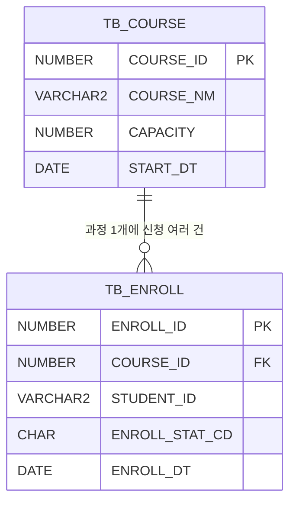

# 테이블 정의서 (1시간 미니판) — 답안

## 1. 컬럼 정의
| 테이블       | 컬럼(영문)         | 한글 이름    | 종류       | 길이  | PK/FK                    | NULL 허용 |
| --------- | -------------- | -------- | -------- | --- | ------------------------ | ------- |
| TB_COURSE | COURSE_ID      | 과정 ID    | NUMBER   | 10  | PK                       | N       |
| TB_COURSE | COURSE_NM      | 과정명      | VARCHAR2 | 100 | -                        | N       |
| TB_COURSE | CAPACITY       | 정원       | NUMBER   | 3   | -                        | N       |
| TB_COURSE | START_DT       | 시작일      | DATE     | -   | -                        | N       |
| TB_ENROLL | ENROLL_ID      | 수강 신청 ID | NUMBER   | 10  | PK                       | N       |
| TB_ENROLL | COURSE_ID      | 과정 ID    | NUMBER   | 10  | FK (TB_COURSE.COURSE_ID) | N       |
| TB_ENROLL | STUDENT_ID     | 수강생 ID   | VARCHAR2 | 20  | -                        | N       |
| TB_ENROLL | ENROLL_STAT_CD | 신청 상태 코드 | CHAR     | 2   | -                        | N       |
| TB_ENROLL | ENROLL_DT      | 신청일      | DATE     | -   | -                        | N       |

## 2. 관계·공통코드·이름 규칙
| 칸                | 내용                                                                  |
| ---------------- | ------------------------------------------------------------------- |
| 두 테이블 관계         | TB_COURSE 1 : N TB_ENROLL (과정 하나에 신청 여러 건)                          |
| 공통코드 그룹 이름       | ENROLL_STAT (신청 상태)                                                 |
| 공통코드 값 (값=뜻, 3개) | 01=신청, 02=대기, 03=취소                                                 |
| 이름 규칙            | 테이블은 `TB_` + 대문자, 컬럼은 대문자·밑줄. 이름은 `_NM`, 날짜는 `_DT`, 코드는 `_CD`로 끝낸다. |

## 3. 🖼 ERD

그림 설명: 그림 2. 수강 신청 ERD

## 스스로 점검
- [x] ★ 모든 컬럼 행에 7칸이 빈칸 없이 채워져 있다
- [x] 🖼 ★ ERD의 테이블·컬럼 이름이 1번 표와 같고 1:N 선이 있다
- [x] ★ N 쪽 테이블에 1 쪽 PK를 가리키는 FK 컬럼이 있다
- [x] 공통코드 값과 뜻이 짝지어 있고 중복이 없다
- [x] 모든 이름이 내가 적은 이름 규칙을 따른다
