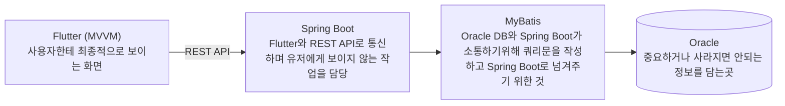

# 프로젝트 계획서 (1시간 미니판)

> 뭐예요? 무엇을 만들고 무엇을 안 만들지 정하는 첫 문서예요.
> 💡 시작 질문: 이번에 *안 만들* 기능 하나는 뭐예요?

## 1. 목표와 범위
| 칸                           | 내용  |
| --------------------------- | --- |
| 목표 (한 문장: 누가 무엇을 할 수 있게 된다) |     |
| 만들 기능 1                     |  수강신청   |
| 만들 기능 2                     |    과정 변경 |
| 만들 기능 3                     |   과제 제출  |
| 안 만들 기능 1개                  |   관리자가 사용자를 등록·수정하는 기능은 만들지 않는다  |

## 2. 계층별 역할
| 계층 | 역할 (한 줄) |
|---|---|
| Flutter (MVVM) |  사용자한테 최종적으로 보이는 화면 |
| Spring Boot | Flutter와 REST API로 통신하며 유저에게 보이지 않는 작업을 담당 |
| MyBatis | Oracle DB와 Spring Boot가 소통하기위해 쿼리문을 작성하고 Spring Boot로 넘겨주기 위한 것 |
| Oracle | 중요하거나 사라지면 안되는 정보를 담는곳 |

## 3. 위험과 대비책
| 위험 | 대비책 |
|---|---|
| 계획서와 코드의 불일치 | 불일치 발생 시 즉시 계획서를 확인하고 고친다 |

## 4. 🖼 구성도
`____`를 위 2번 표의 역할로 바꿔요.

그림 설명: ____

## 스스로 점검
- [v] ★ 만들 기능 3개·안 만들 기능 1개가 "누가 무엇을 한다" 형태다
- [v] ★ 계층 4개의 역할이 한 줄씩 있다
- [v] 목표에 "누가 무엇을 할 수 있게 된다"가 들어 있다
- [v] 🖼 구성도에 계층 4개와 화살표가 있고 이름이 2번 표와 같다
- [v] 위험 1개와 대비책 1개가 함께 있다
