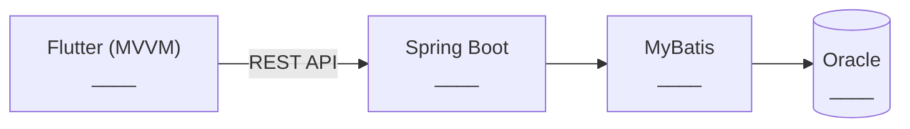

# 프로젝트 계획서 (1시간 미니판)

> 뭐예요? 무엇을 만들고 무엇을 안 만들지 정하는 첫 문서예요.
> 💡 시작 질문: 이번에 *안 만들* 기능 하나는 뭐예요?

## 1. 목표와 범위
| 칸 | 내용 |
|---|---|
| 목표 (한 문장: 누가 무엇을 할 수 있게 된다) |  |
| 만들 기능 1 |  |
| 만들 기능 2 |  |
| 만들 기능 3 |  |
| 안 만들 기능 1개 |  |

## 2. 계층별 역할
| 계층 | 역할 (한 줄) |
|---|---|
| Flutter (MVVM) |  |
| Spring Boot |  |
| MyBatis |  |
| Oracle |  |

## 3. 위험과 대비책
| 위험 | 대비책 |
|---|---|
|  |  |

## 4. 🖼 구성도
`____`를 위 2번 표의 역할로 바꿔요.

그림 설명: ____

## 스스로 점검
- [ ] ★ 만들 기능 3개·안 만들 기능 1개가 "누가 무엇을 한다" 형태다
- [ ] ★ 계층 4개의 역할이 한 줄씩 있다
- [ ] 목표에 "누가 무엇을 할 수 있게 된다"가 들어 있다
- [ ] 🖼 구성도에 계층 4개와 화살표가 있고 이름이 2번 표와 같다
- [ ] 위험 1개와 대비책 1개가 함께 있다
