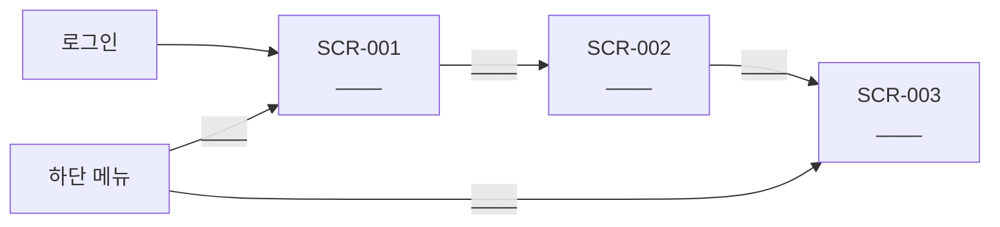

# 화면 설계서 (1시간 미니판)

> 뭐예요? 화면마다 무엇이 보이고, 무엇을 입력하고, 버튼을 누르면 무슨 일이 생기는지 적은 문서예요. Flutter 개발자가 이 문서만 보고 화면을 만들 수 있어야 해요.
> 💡 시작 질문: 수강 신청 버튼을 누르면 서버에 무엇을 보내고, 성공하면 어느 화면으로 가야 할까요?
> 칸에 넣을 게 없으면 비워 두지 말고 `-`를 써요.

## 0. 개정 이력
| 버전 | 날짜 | 작성자 | 바꾼 내용 |
|---|---|---|---|
| v0.1 |  |  | 처음 작성 |

## 1. 🖼 메뉴 구조·화면 흐름
`____`를 내 화면 이름과 버튼 이름으로 바꿔요. 화면 3개가 모두 나와야 해요.

## 2. 화면 목록
접근 칸에는 들어갈 수 있으면 `O`, 없으면 `X`를 써요.

| 화면 ID | 화면 이름 | 설명 (한 줄) | 관련 FR | 들어오는 길 | 관리자 | 강사 | 수강생 |
|---|---|---|---|---|---|---|---|
| SCR-001 |  |  |  |  |  |  |  |
| SCR-002 |  |  |  |  |  |  |  |
| SCR-003 |  |  |  |  |  |  |  |

## 3. 🖼 화면 스케치
화면 3개를 모두 그려요(한 장에 나란히 그려도 돼요). 그림 속 칸·버튼 이름은 4~6번 표와 같게 적어요.
그린 뒤 **Win + Shift + S**로 캡처하고, 이 줄 아래에 **Ctrl + V** 해요.

그림 설명: ____

## 4. 입력 항목 (사용자가 입력하거나 고르는 칸)
| 화면 ID | 항목 이름 | 종류 (글자 입력 / 선택 / 숨김 값 등) | 필수 | 길이·형식 | 기본값 | 검사 규칙 | 규칙에 안 맞을 때 메시지 ID |
|---|---|---|---|---|---|---|---|
|  |  |  |  |  |  |  |  |
|  |  |  |  |  |  |  |  |
|  |  |  |  |  |  |  |  |

## 5. 출력 항목 (화면에 보이는 값)
| 화면 ID | 항목 이름 | 보이는 형식 (예: yyyy-MM-dd, "30명") | 값을 가져오는 곳 (API 응답 필드 ← 테이블.컬럼) |
|---|---|---|---|
|  |  |  |  |
|  |  |  |  |
|  |  |  |  |
|  |  |  |  |
|  |  |  |  |
|  |  |  |  |

## 6. 이벤트 (버튼을 누르거나 화면이 열릴 때)
화면 이동만 하면 API 칸에 "없음(화면 이동)"이라고 써요.

| 화면 ID | 이벤트 | 처리 내용 | 호출 API ID | 성공하면 | 실패하면 (메시지 ID) |
|---|---|---|---|---|---|
|  |  |  |  |  |  |
|  |  |  |  |  |  |
|  |  |  |  |  |  |
|  |  |  |  |  |  |
|  |  |  |  |  |  |
|  |  |  |  |  |  |

## 7. 메시지
목록이 비었을 때 보여 줄 안내 문장도 넣어요.

| 메시지 ID | 종류 (성공 / 오류 / 안내) | 문장 (화면에 그대로 띄울 문장) | 쓰는 화면 |
|---|---|---|---|
| MSG-001 |  |  |  |
| MSG-002 |  |  |  |
| MSG-003 |  |  |  |
| MSG-004 |  |  |  |

## 스스로 점검
- [ ] ★ 화면 3개 모두 이름·설명·관련 FR·들어오는 길이 있다
- [ ] 🖼 메뉴 흐름에 화면 3개와 이동 화살표가 모두 있다
- [ ] 🖼 ★ 화면 3개 스케치가 있고 칸·버튼 이름이 표와 같다
- [ ] ★ 입력 항목마다 8칸이 채워져 있다
- [ ] 출력 항목마다 형식과 값을 가져오는 곳이 있다
- [ ] ★ 이벤트마다 처리 내용·API·성공하면·실패하면이 있다
- [ ] 메시지마다 ID·종류·문장·쓰는 화면이 있고 빈 목록 안내가 있다
- [ ] 화면마다 관리자·강사·수강생 접근이 O/X로 있다
- [ ] 개정 이력에 버전·날짜·작성자·바꾼 내용이 있다
