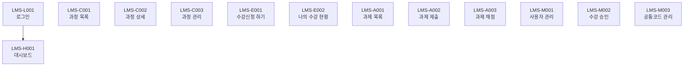

# LMS 화면 설계서 (1시간 미니판)

> 뭐예요? 실제 LMS 앱의 화면 **13개**를 빠짐없이 정리하고, 내가 고른 기능 3개에 쓰는 화면은 자세히 적는 문서예요.
> 💡 시작 질문: 학습자가 수강신청을 하려면 어떤 화면들을 차례로 지나가나요?
> 원본: `참고/LMS_실제_화면.md` (볼트 원본: `03 프로젝트 산출물/LMS 메뉴구조도.md`)
> 화면 ID·이름·접근 권한은 실제 메뉴구조도에서 옮겨 뒀어요. **빈칸만** 채워요. 넣을 게 없으면 `-`를 써요.

## 0. 개정 이력
| 버전 | 날짜 | 작성자 | 바꾼 내용 |
|---|---|---|---|
| v0.1 |  |  | 처음 작성 |

## 1. 화면 목록 (13개)
학습자=S, 강사=T, 관리자=A. 들어갈 수 있으면 `O`, 없으면 `X`예요.

| 화면 ID | 화면 이름 | 설명 | 관련 요구사항 | 진입 경로 | 학습자 | 강사 | 관리자 |
|---|---|---|---|---|---|---|---|
| LMS-L001 | 로그인 |  |  |  | O | O | O |
| LMS-H001 | 대시보드 |  |  |  | O | O | O |
| LMS-C001 | 과정 목록 |  |  |  | O | O | O |
| LMS-C002 | 과정 상세 |  |  |  | O | O | O |
| LMS-C003 | 과정 관리 |  |  |  | X | O | O |
| LMS-E001 | 수강신청 하기 |  |  |  | O | X | X |
| LMS-E002 | 나의 수강 현황 |  |  |  | O | X | X |
| LMS-A001 | 과제 목록 |  |  |  | O | O | X |
| LMS-A002 | 과제 제출 |  |  |  | O | X | X |
| LMS-A003 | 과제 채점 |  |  |  | X | O | X |
| LMS-M001 | 사용자 관리 |  |  |  | X | X | O |
| LMS-M002 | 수강 승인 |  |  |  | X | X | O |
| LMS-M003 | 공통코드 관리 |  |  |  | X | X | O |

## 2. 🖼 메뉴 구조·화면 흐름
화면 13개는 그려 두었어요. 맨 아래에 `L001 --> H001`처럼 **화살표 줄을 한 줄씩 더해** 화면을 이어요.
화살표 위에 글자는 쓰지 않아요. 이동 조건은 3번 표에 적어요.

## 3. 화면 이동
| 출발 화면 | 도착 화면 | 이동 조건 (버튼·메뉴·권한) |
|---|---|---|
| LMS-L001 | LMS-H001 | 로그인 성공 |
|  |  |  |
|  |  |  |
|  |  |  |
|  |  |  |
|  |  |  |
|  |  |  |
|  |  |  |
|  |  |  |
|  |  |  |
|  |  |  |
|  |  |  |
|  |  |  |

## 4. 빠진 화면 찾기
요구사항(LMS-001~012) 중 맞는 화면이 없는 것을 찾아요.

| 요구사항 | 왜 화면이 없다고 보나 | 어떻게 하면 좋을까 |
|---|---|---|
|  |  |  |

---
아래 5~9번은 **내가 고른 기능 3개에 쓰는 화면만** 적어요.

## 5. 🖼 화면 스케치
기능 3개에 쓰는 화면을 모두 그려요(한 장에 나란히 그려도 돼요). 칸·버튼 이름은 6~8번 표와 같게 적어요.
그린 뒤 **Win + Shift + S**로 캡처하고, 이 줄 아래에 **Ctrl + V** 해요.

그림 설명: ____

## 6. 입력 항목
| 화면 ID | 항목 | 종류 | 필수 | 길이·형식 | 기본값 | 검사 규칙 | 오류 메시지 |
|---|---|---|---|---|---|---|---|
|  |  |  |  |  |  |  |  |
|  |  |  |  |  |  |  |  |
|  |  |  |  |  |  |  |  |

## 7. 출력 항목
| 화면 ID | 항목 | 보이는 형식 | 값 출처 (API 필드 ← 테이블.컬럼) |
|---|---|---|---|
|  |  |  |  |
|  |  |  |  |
|  |  |  |  |
|  |  |  |  |
|  |  |  |  |

## 8. 이벤트
화면 이동만 하면 API 칸에 `없음(화면 이동)`이라고 써요.

| 화면 ID | 이벤트 | 처리 내용 | API | 성공하면 | 실패하면 |
|---|---|---|---|---|---|
|  |  |  |  |  |  |
|  |  |  |  |  |  |
|  |  |  |  |  |  |
|  |  |  |  |  |  |

## 9. 메시지
목록이 비었을 때 보여 줄 안내 문장도 넣어요.

| 메시지 ID | 종류 | 문장 | 쓰는 화면 |
|---|---|---|---|
| MSG-001 |  |  |  |
| MSG-002 |  |  |  |
| MSG-003 |  |  |  |
| MSG-004 |  |  |  |

## 스스로 점검
- [ ] ★ 화면 13개 모두 설명·관련 요구사항·진입 경로가 있다
- [ ] 🖼 메뉴 흐름에서 화면 13개가 모두 화살표로 이어져 있다
- [ ] 화면 이동 표에 화살표마다 이동 조건이 있다
- [ ] 화면이 없는 요구사항을 찾아 적었다
- [ ] 🖼 ★ 기능 3개에 쓰는 화면이 모두 스케치에 있다
- [ ] ★ 입력 항목마다 8칸이 채워져 있다
- [ ] 출력 항목마다 형식과 값 출처가 있다
- [ ] ★ 이벤트마다 처리 내용·API·성공하면·실패하면이 있다
- [ ] 메시지마다 ID·종류·문장·쓰는 화면이 있고 빈 목록 안내가 있다
- [ ] 개정 이력에 버전·날짜·작성자·바꾼 내용이 있다
