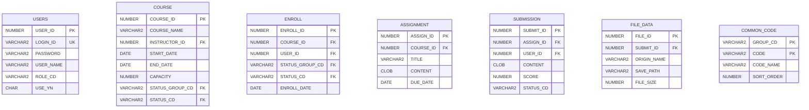

# LMS 테이블 정의서 (1시간 미니판)

> 뭐예요? 실제 LMS DB에 있는 테이블 **7개, 컬럼 40개**를 빠짐없이 정리하고, 문제점을 찾는 문서예요.
> 💡 시작 질문: 수강신청(ENROLL) 한 건은 어떤 테이블 두 개와 이어져 있나요?
> 원본 DDL: `참고/LMS_실제_테이블.md` (볼트 원본: `03 프로젝트 산출물/LMS/LMS 테이블 정의서.md`)
> 테이블·컬럼·종류·길이·PK·FK·NULL은 실제 DDL에서 옮겨 뒀어요. **빈칸만** 채워요. 넣을 게 없으면 `-`를 써요.

## 0. 개정 이력
| 버전 | 날짜 | 작성자 | 바꾼 내용 |
|---|---|---|---|
| v0.1 |  |  | 처음 작성 |

## 1. 테이블 목록 (7개)
| 테이블 | 한글 이름 | 무엇을 저장하나 | 관련 요구사항 |
|---|---|---|---|
| USERS |  |  |  |
| COURSE |  |  |  |
| ENROLL |  |  |  |
| ASSIGNMENT |  |  |  |
| SUBMISSION |  |  |  |
| FILE_DATA |  |  |  |
| COMMON_CODE |  |  |  |

## 2. 컬럼 정의 (40개)
| 테이블         | 컬럼              | 한글 이름 | 종류       | 길이  | PK/UK | FK (참조)                   | NULL | 기본값 | 개인정보 | 설명  |
| ----------- | --------------- | ----- | -------- | --- | ----- | ------------------------- | ---- | --- | ---- | --- |
| USERS       | USER_ID         |       | NUMBER   | -   | PK    | -                         | N    |     |      |     |
| USERS       | LOGIN_ID        |       | VARCHAR2 | 50  | UK    | -                         | Y    |     |      |     |
| USERS       | PASSWORD        |       | VARCHAR2 | 100 | -     | -                         | Y    |     |      |     |
| USERS       | USER_NAME       |       | VARCHAR2 | 50  | -     | -                         | Y    |     |      |     |
| USERS       | ROLE_CD         |       | VARCHAR2 | 10  | -     | -                         | Y    |     |      |     |
| USERS       | USE_YN          |       | CHAR     | 1   | -     | -                         | Y    |     |      |     |
| COURSE      | COURSE_ID       |       | NUMBER   | -   | PK    | -                         | N    |     |      |     |
| COURSE      | COURSE_NAME     |       | VARCHAR2 | 100 | -     | -                         | Y    |     |      |     |
| COURSE      | INSTRUCTOR_ID   |       | NUMBER   | -   | -     | USERS.USER_ID             | Y    |     |      |     |
| COURSE      | START_DATE      |       | DATE     | -   | -     | -                         | Y    |     |      |     |
| COURSE      | END_DATE        |       | DATE     | -   | -     | -                         | Y    |     |      |     |
| COURSE      | CAPACITY        |       | NUMBER   | -   | -     | -                         | Y    |     |      |     |
| COURSE      | STATUS_GROUP_CD |       | VARCHAR2 | 20  | -     | COMMON_CODE.GROUP_CD (복합) | Y    |     |      |     |
| COURSE      | STATUS_CD       |       | VARCHAR2 | 10  | -     | COMMON_CODE.CODE (복합)     | Y    |     |      |     |
| ENROLL      | ENROLL_ID       |       | NUMBER   | -   | PK    | -                         | N    |     |      |     |
| ENROLL      | COURSE_ID       |       | NUMBER   | -   | -     | COURSE.COURSE_ID          | Y    |     |      |     |
| ENROLL      | USER_ID         |       | NUMBER   | -   | -     | USERS.USER_ID             | Y    |     |      |     |
| ENROLL      | STATUS_GROUP_CD |       | VARCHAR2 | 20  | -     | COMMON_CODE.GROUP_CD (복합) | Y    |     |      |     |
| ENROLL      | STATUS_CD       |       | VARCHAR2 | 10  | -     | COMMON_CODE.CODE (복합)     | Y    |     |      |     |
| ENROLL      | ENROLL_DATE     |       | DATE     | -   | -     | -                         | Y    |     |      |     |
| ASSIGNMENT  | ASSIGN_ID       |       | NUMBER   | -   | PK    | -                         | N    |     |      |     |
| ASSIGNMENT  | COURSE_ID       |       | NUMBER   | -   | -     | COURSE.COURSE_ID          | Y    |     |      |     |
| ASSIGNMENT  | TITLE           |       | VARCHAR2 | 200 | -     | -                         | Y    |     |      |     |
| ASSIGNMENT  | CONTENT         |       | CLOB     | -   | -     | -                         | Y    |     |      |     |
| ASSIGNMENT  | DUE_DATE        |       | DATE     | -   | -     | -                         | Y    |     |      |     |
| SUBMISSION  | SUBMIT_ID       |       | NUMBER   | -   | PK    | -                         | N    |     |      |     |
| SUBMISSION  | ASSIGN_ID       |       | NUMBER   | -   | -     | ASSIGNMENT.ASSIGN_ID      | Y    |     |      |     |
| SUBMISSION  | USER_ID         |       | NUMBER   | -   | -     | USERS.USER_ID             | Y    |     |      |     |
| SUBMISSION  | CONTENT         |       | CLOB     | -   | -     | -                         | Y    |     |      |     |
| SUBMISSION  | SCORE           |       | NUMBER   | -   | -     | -                         | Y    |     |      |     |
| SUBMISSION  | STATUS_CD       |       | VARCHAR2 | 10  | -     | -                         | Y    |     |      |     |
| FILE_DATA   | FILE_ID         |       | NUMBER   | -   | PK    | -                         | N    |     |      |     |
| FILE_DATA   | SUBMIT_ID       |       | NUMBER   | -   | -     | SUBMISSION.SUBMIT_ID      | Y    |     |      |     |
| FILE_DATA   | ORIGIN_NAME     |       | VARCHAR2 | 255 | -     | -                         | Y    |     |      |     |
| FILE_DATA   | SAVE_PATH       |       | VARCHAR2 | 500 | -     | -                         | Y    |     |      |     |
| FILE_DATA   | FILE_SIZE       |       | NUMBER   | -   | -     | -                         | Y    |     |      |     |
| COMMON_CODE | GROUP_CD        |       | VARCHAR2 | 20  | PK    | -                         | N    |     |      |     |
| COMMON_CODE | CODE            |       | VARCHAR2 | 10  | PK    | -                         | N    |     |      |     |
| COMMON_CODE | CODE_NAME       |       | VARCHAR2 | 50  | -     | -                         | Y    |     |      |     |
| COMMON_CODE | SORT_ORDER      |       | NUMBER   | -   | -     | -                         | Y    |     |      |     |

## 3. 🖼 ERD
테이블 7개는 그려 두었어요. 아래 `%%` 줄의 `%%`를 지우고 `____`를 채워 **관계 9개**를 모두 이어요. 2번 표의 FK 칸을 보면 찾을 수 있어요.

그림 설명: ____

## 4. 관계 (FK 9개)
| 부모 (1) | 자식 (N) | 연결 컬럼 (FK) | 부모 행을 지우면 |
|---|---|---|---|
|  |  |  |  |
|  |  |  |  |
|  |  |  |  |
|  |  |  |  |
|  |  |  |  |
|  |  |  |  |
|  |  |  |  |
|  |  |  |  |
|  |  |  |  |

## 5. 공통코드 (실제 데이터 13개)
| 코드 그룹         | 코드 값 | 코드 이름 | 쓰는 컬럼 | 쓰는 화면 |
| ------------- | ---- | ----- | ----- | ----- |
| ROLE          | S    | 학생    |       |       |
| ROLE          | T    | 강사    |       |       |
| ROLE          | A    | 관리자   |       |       |
| COURSE_STATUS | 10   | 준비중   |       |       |
| COURSE_STATUS | 20   | 모집중   |       |       |
| COURSE_STATUS | 30   | 진행중   |       |       |
| COURSE_STATUS | 40   | 종료    |       |       |
| COURSE_STATUS | 50   | 폐강    |       |       |
| ENROLL_STATUS | 10   | 신청    |       |       |
| ENROLL_STATUS | 20   | 승인    |       |       |
| ENROLL_STATUS | 30   | 반려    |       |       |
| SUBMIT_STATUS | 10   | 제출    |       |       |
| SUBMIT_STATUS | 20   | 채점완료  |       |       |

## 6. 제약조건·인덱스 (실제 DDL에 있는 것)
| 이름  | 테이블 | 종류  | 대상 컬럼 | 왜 필요한가 |
| --- | --- | --- | ----- | ------ |
|     |     |     |       |        |
|     |     |     |       |        |
|     |     |     |       |        |
|     |     |     |       |        |

## 7. 개인정보 컬럼
| 테이블.컬럼 | 무슨 정보 | 보호 방법 | 볼 수 있는 사람 |
|---|---|---|---|
|  |  |  |  |
|  |  |  |  |

## 8. 이름 규칙
| 대상 | 실제 DDL의 규칙 | ERD 문서(`LMS ERD.md`)와 같은가 |
|---|---|---|
| 테이블 |  |  |
| 컬럼 |  |  |
| 제약조건 |  |  |

## 9. 문제점과 개선 DDL (3개 이상)
요구사항·ERD 문서와 비교해 실제 DDL에서 빠졌거나 다른 것을 찾아요.

| 번호 | 문제 (어디가, 무엇이) | 왜 문제인가 |
|---|---|---|
| 1 |  |  |
| 2 |  |  |
| 3 |  |  |

```sql
-- 위 문제를 고치는 SQL (ALTER TABLE / CREATE INDEX 등)
____
```

## 스스로 점검
- [ ] ★ 테이블 7개 모두 한글 이름·저장하는 것·관련 요구사항이 있다
- [ ] ★ 컬럼 40개 모두 한글 이름·기본값·개인정보·설명이 채워져 있다 (없으면 `-`)
- [ ] 🖼 ★ ERD에 관계 9개가 모두 이어져 있다
- [ ] ★ 관계 표에 FK 9개가 모두 있다
- [ ] 공통코드 13개마다 쓰는 컬럼·쓰는 화면이 있다
- [ ] 제약조건마다 왜 필요한지가 있다
- [ ] 개인정보 컬럼마다 보호 방법과 볼 수 있는 사람이 있다
- [ ] 이름 규칙을 ERD 문서와 비교했다
- [ ] 문제점 3개 이상과 고치는 SQL이 있다
- [ ] 개정 이력에 버전·날짜·작성자·바꾼 내용이 있다
