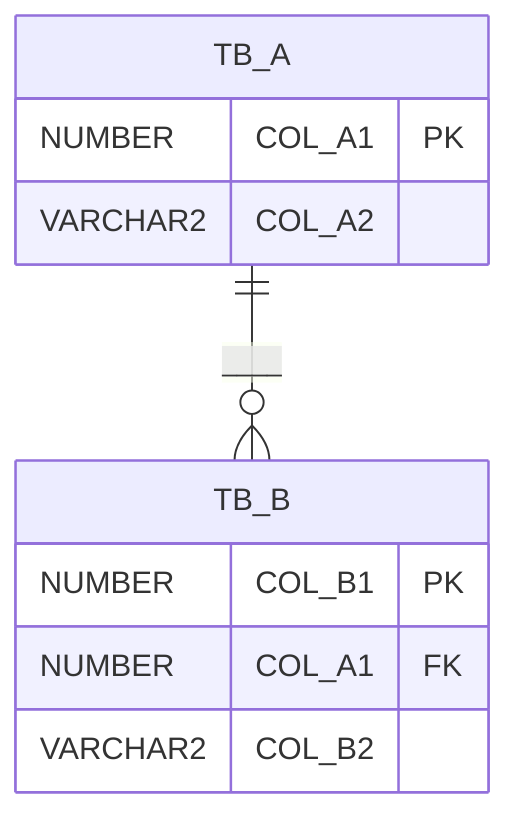

# 테이블 정의서 (1시간 미니판)

> 뭐예요? 데이터를 담을 표(테이블)의 설계도예요. 개발자가 이 문서만 보고 DB를 만들 수 있어야 해요.
> 💡 시작 질문: 기능 3개를 하려면 꼭 저장해야 하는 것 두 개는 뭐예요?
> 칸에 넣을 게 없으면 비워 두지 말고 `-`를 써요.

## 0. 개정 이력
| 버전 | 날짜 | 작성자 | 바꾼 내용 |
|---|---|---|---|
| v0.1 |  |  | 처음 작성 |

## 1. 테이블 목록
| 테이블(영문) | 테이블 이름(한글) | 무엇을 저장하나 (한 줄) | 관련 FR |
|---|---|---|---|
|  |  |  |  |
|  |  |  |  |

## 2. 컬럼 정의 (테이블 2개, 각 4~5개 컬럼)
| 테이블 | 컬럼(영문) | 컬럼 이름(한글) | 종류 | 길이 | PK | FK (참조 테이블.컬럼) | NULL 허용 | 기본값 | 개인정보 | 설명 |
|---|---|---|---|---|---|---|---|---|---|---|
|  |  |  |  |  |  |  |  |  |  |  |
|  |  |  |  |  |  |  |  |  |  |  |
|  |  |  |  |  |  |  |  |  |  |  |
|  |  |  |  |  |  |  |  |  |  |  |
|  |  |  |  |  |  |  |  |  |  |  |
|  |  |  |  |  |  |  |  |  |  |  |
|  |  |  |  |  |  |  |  |  |  |  |
|  |  |  |  |  |  |  |  |  |  |  |
|  |  |  |  |  |  |  |  |  |  |  |
|  |  |  |  |  |  |  |  |  |  |  |

## 3. 🖼 ERD
`TB_A`, `TB_B`와 컬럼 이름을 2번 표와 같은 이름으로 바꿔요. `||--o{`는 "1 : N"이라는 뜻이에요.

그림 설명: ____

## 4. 관계
| 부모 테이블 (1) | 자식 테이블 (N) | 연결 컬럼 (FK) | 부모 행을 지우면 |
|---|---|---|---|
|  |  |  | (예: 자식이 있으면 지울 수 없음) |

## 5. 공통코드
| 코드 그룹 | 그룹 이름 | 코드 값 | 코드 이름 | 쓰는 컬럼 | 쓰는 화면 |
|---|---|---|---|---|---|
|  |  |  |  |  |  |
|  |  |  |  |  |  |
|  |  |  |  |  |  |

## 6. 제약조건·인덱스 (PK·FK·CHECK·UNIQUE 중 있는 것 + 인덱스 1개 이상)
| 이름 | 테이블 | 종류 | 대상 컬럼 | 왜 필요한가 |
|---|---|---|---|---|
|  |  |  |  |  |
|  |  |  |  |  |
|  |  |  |  |  |
|  |  |  |  |  |

## 7. 개인정보 컬럼
개인정보 컬럼이 없으면 표 대신 "개인정보 컬럼 없음 — 이유: ____"라고 써요.

| 테이블.컬럼 | 무슨 정보 | 보호 방법 (암호화 / 가림 / 저장 안 함 등) | 볼 수 있는 사람 |
|---|---|---|---|
|  |  |  |  |

## 8. 이름 규칙
| 대상 | 규칙 |
|---|---|
| 테이블 | (예: `TB_` + 대문자) |
| 컬럼 | (예: 대문자·밑줄, 이름은 `_NM`, 날짜는 `_DT`, 코드는 `_CD`로 끝냄) |
| 제약조건·인덱스 | (예: `PK_`, `FK_`, `UK_`, `CK_`, `IX_` + 테이블 이름) |

## 9. DDL·초기 데이터
2번 표와 이름·종류·길이·NULL이 같아야 해요.
```sql
CREATE TABLE ____ (
  ____ NUMBER(__) NOT NULL,
  ____ VARCHAR2(__) NOT NULL,
  CONSTRAINT PK_____ PRIMARY KEY (____)
);

CREATE TABLE ____ (
  ____ NUMBER(__) NOT NULL,
  ____ NUMBER(__) NOT NULL,
  CONSTRAINT PK_____ PRIMARY KEY (____),
  CONSTRAINT FK_____ FOREIGN KEY (____) REFERENCES ____ (____)
);

-- 초기 데이터 (시험할 때 쓸 데이터 1건 이상)
INSERT INTO ____ VALUES (____);
```

## 스스로 점검
- [ ] ★ 테이블마다 영문·한글 이름, 저장하는 것, 관련 FR이 있다
- [ ] ★ 컬럼 표의 모든 행에 11칸이 채워져 있다 (해당 없으면 `-`)
- [ ] 🖼 ★ ERD의 테이블·컬럼 이름이 2번 표와 같고 1:N 선이 있다
- [ ] ★ 관계 표에 부모·자식·FK·지울 때 규칙이 있다
- [ ] 공통코드마다 값·이름·쓰는 컬럼·쓰는 화면이 있고 값이 겹치지 않는다
- [ ] 제약조건과 인덱스 1개 이상에 이유가 있다
- [ ] 개인정보 컬럼마다 보호 방법과 볼 수 있는 사람이 있다 (없으면 이유)
- [ ] DDL이 2번 표와 같고 초기 데이터가 1건 이상 있다
- [ ] 모든 이름이 8번 이름 규칙을 따른다
- [ ] 개정 이력에 버전·날짜·작성자·바꾼 내용이 있다
